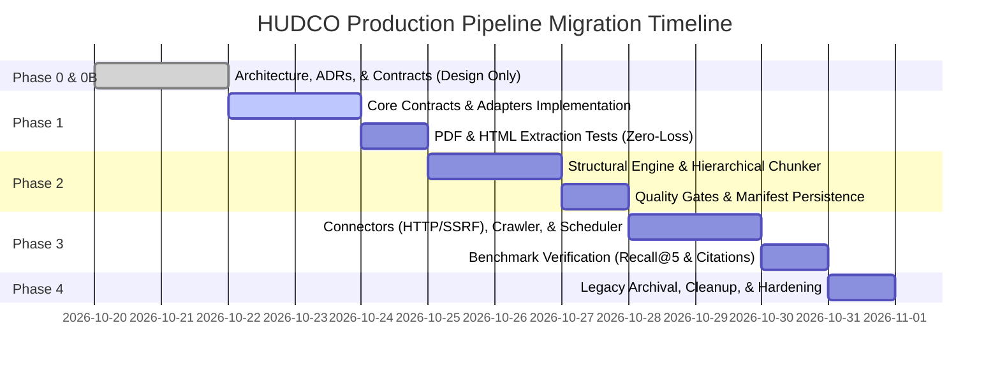

# Repository Migration, Cleanup, and Component Disposition Plan

**Document Identifier**: `HUDCO-DOCPROC-MIGRATION-2026-V2`  
**Target Path**: `docs/MIGRATION_AND_CLEANUP_PLAN.md`  
**Status**: Approved Phase 0B Planning Blueprint (Cross-Validated and Extended)  
**Auditor / Architect**: Senior AI/ML Engineer & Forensic Technical Auditor  
**Scope**: Complete inventory of all existing repository files, cross-document discrepancy reconciliation, disposition classifications (KEEP, REWRITE, ARCHIVE, REMOVE), defect analysis, dependency justifications, and phased migration sequence.

---

## 1. Disposition Classification Taxonomy

To ensure disciplined architectural hygiene without premature deletion of historical evidence, every existing file in the repository is classified into one of four immutable categories:

1. **KEEP**: Working, verified, high-value component compatible with the clean architecture. Maintained in the active codebase.
2. **REWRITE**: Necessary functional responsibility, but current implementation contains known defects, unhandled edge cases, or broken abstractions. Reimplemented cleanly in the new pipeline.
3. **ARCHIVE**: Historical run record, legacy output, or forensic baseline. Retained strictly read-only under `archive/` or historical directories for auditability, but completely disconnected from active execution paths.
4. **REMOVE**: Redundant, dead, or completely obsolete file with zero callers, no historical provenance value, and unfulfilled external dependencies. Removed only after verification in Phase 4.

> [!IMPORTANT]
> **Strict Phase 0B Non-Invasive Constraint**: No files are deleted, renamed, moved, or modified during Phase 0B. All existing source code, manifests, PDFs, and tests remain completely untouched. This document serves as the approved migration blueprint for subsequent implementation phases.

---

## 2. Cross-Document Discrepancy Table & Resolutions

During Phase 0B cross-validation of the initial five Phase 0 design documents, the following discrepancies were identified and resolved across the architecture:

| Document | Exact Issue | Why It Matters | Proposed Resolution | Affected Files | Status |
|---|---|---|---|---|---|
| `docs/ARCHITECTURE.md` vs `docs/DATA_CONTRACTS.md` | `CanonicalSection.printed_page_start` type mismatch: Architecture allowed string or integer, but evaluation schemas had `Optional[int]`. | Annual reports frequently contain Roman numerals (`iv`, `x`) in front matter. An integer field causes validation crashes on Roman pages. | Standardized `printed_page_start` and `printed_page_end` as `Optional[str]` across all canonical contracts. | `docs/DATA_CONTRACTS.md`, `docs/ARCHITECTURE.md` | **RESOLVED** |
| `docs/ARCHITECTURE.md` | Chunk ID formula omitted document version (`{doc_id}_{sec}_p{page}_c{idx}`). | If a document is revised (e.g. Circular updated or AR revised), new chunks collide with old chunk IDs in vector DBs and evaluation sets. | Revised formula to `{document_id}_v{version}_{hash8}_{section_id}_p{page:03d}_c{idx:02d}`. Guaranteed globally unique across document revisions. | `docs/ARCHITECTURE.md`, `docs/DATA_CONTRACTS.md`, `docs/DECISIONS.md` | **RESOLVED** |
| `docs/ARCHITECTURE.md` | Stage 1 conflated local filesystem intake with web crawling and direct URL downloads in a single module. | Crawling requires sitemaps, pagination, robots.txt, and rate limiting; local intake only requires watching directories. Blending them creates monolithic code. | Decoupled into `pipeline/connectors/` (`filesystem.py`, `http_fetcher.py`, `crawler.py`) separate from format adapters in `pipeline/adapters/`. | `docs/ARCHITECTURE.md`, `docs/PIPELINE_FLOW.md`, `docs/SOURCE_CONNECTORS_AND_AUTOMATION.md` | **RESOLVED** |
| `docs/DATA_CONTRACTS.md` | Lacked explicit schemas for discovery, web crawls, and incremental version lineage. | Ingestion could not formally represent sitemap discoveries, HTTP ETags, or document version transitions. | Added `SourceConfiguration`, `DiscoveredResource`, `FetchResult`, `SourceRecord`, `DocumentVersion`, and `CrawlRunManifest`. | `docs/DATA_CONTRACTS.md` | **RESOLVED** |
| `docs/DECISIONS.md` | Lacked explicit decision records for network security (SSRF), crawler bounds, change detection, and scheduling. | Left network security, rate limiting, and crawl looping unaddressed. | Added ADR-12 (Safe Acquisition/SSRF), ADR-13 (Change Detection/Versioning), ADR-14 (Scheduling/Mutex), ADR-15 (Versioned Chunk IDs), ADR-16 (Future Formats). | `docs/DECISIONS.md` | **RESOLVED** |
| `docs/PIPELINE_FLOW.md` | Only showed happy path for local files; lacked flows for web crawling, SSRF checks, and incremental change detection. | Operators and developers could not visualize the crawler lifecycle, SSRF defense, or version branching. | Added 4 new Mermaid diagrams: Multi-Source Acquisition, Web Crawling Lifecycle, SSRF Protection Sequence, and Incremental Change Detection State Machine. | `docs/PIPELINE_FLOW.md` | **RESOLVED** |

---

## 3. Complete File-by-File Repository Inventory

The repository contains 37 files across source, data, configuration, evaluation, documentation, and test trees. Below is the exhaustive audit of every component:

### 3.1 Configuration & Environment Files

| Relative Path | Current Responsibility | Dependencies & Callers | Execution & Test Status | Design Rationale | Known Defects & Limitations | Disposition | Supporting Evidence |
|---|---|---|---|---|---|---|---|
| `config/__init__.py` | Package initializer for config module. | Imported by `settings.py`. | Executed during import. | Standard Python package structure. | None. | **KEEP** | Standard package file. |
| `config/settings.py` | Pydantic Settings singleton managing environment variables, directory paths, and thresholds. | Imported by `pipeline/stage_1_ingestion/`, `stage_3_structuring/`, `stage_4_storage/`. | Executed in Stage 1 and tests. | Centralized application configuration. | Imports `pydantic_settings`. Contains hardcoded database/redis connection strings for unbuilt components (`DATABASE_URL`, `REDIS_URL`). | **REWRITE** | Refactor into clean, minimal pipeline configuration in `pipeline/config.py` without unused DB/Redis strings. |
| `requirements.txt` | Package dependency declarations. | Used by pip. | Partially installed in `.venv`. | Python dependency manifest. | Core packages active (`pypdf`, `requests`, `pydantic`), but 9 packages are commented out (`pdfplumber`, `chromadb`, `sentence-transformers`, `sqlalchemy`, `trafilatura`, `bs4`, `fastapi`). | **REWRITE** | Update with verified minimal dependencies (`pypdf`, `pydantic`, `pdfplumber`, `beautifulsoup4`, `lxml`). |
| `.python-version` | Specifies Python runtime version (3.12.10). | Used by `pyenv` / IDEs. | Verified. | Environment consistency. | None. | **KEEP** | Accurate environment marker. |

---

### 3.2 Historical Pipeline Stage 1: Ingestion & Segmentation

| Relative Path | Current Responsibility | Dependencies & Callers | Execution & Test Status | Design Rationale | Known Defects & Limitations | Disposition | Supporting Evidence |
|---|---|---|---|---|---|---|---|
| `pipeline/stage_1_ingestion/__init__.py` | Package initializer. | None. | Executed during import. | Standard package structure. | None. | **ARCHIVE** | Historical package. |
| `pipeline/stage_1_ingestion/run_stage1.py` | Stage 1 CLI runner & orchestrator. Executes download, fingerprint, TOC analysis, and PDF splitting. | Calls `downloader.py`, `fingerprint.py`, `segmenter.py`. | **CONFIRMED EXECUTION**: Ran on 2026-09-23 producing 19 PDFs in `data/intermediate/sections/`. | Orchestrate end-to-end ingestion and segmentation. | Forces physical PDF slicing on disk. Applies universal `+2` offset heuristic, shifting boundaries for multiple sections. Drops front matter pages 1–19. | **ARCHIVE** | Historical orchestrator. Replaced by `pipeline/cli.py` and virtual segmentation. |
| `pipeline/stage_1_ingestion/downloader.py` | Document downloader with SHA-256 computation and local registry deduplication. | Called by `run_stage1.py`. | **CONFIRMED EXECUTION**: Ingested `ar26.pdf` on 2026-09-23. | Streaming download with deduplication. | Solid streaming SHA-256 logic, but couples download directly with local `document_registry.json` without atomic write locks or SSRF protection. | **REWRITE** | Logic is sound; adapt into `pipeline/connectors/http_fetcher.py` with SSRF guards. |
| `pipeline/stage_1_ingestion/fingerprint.py` | Extracts title, fiscal year, and edition hints from initial PDF pages. | Called by `run_stage1.py`. | **CONFIRMED EXECUTION**: Inferred `Annual Report 2025-26`. | Heuristic metadata extraction. | Uses rigid regular expressions that may not generalize beyond annual reports. | **REWRITE** | Generalize and incorporate into `pipeline/core/intake.py`. |
| `pipeline/stage_1_ingestion/segmenter.py` | PDF structural inspection, TOC discovery, printed-to-physical mapping, and physical PDF splitting. | Called by `run_stage1.py`. | **CONFIRMED EXECUTION**: Created 19 section PDFs. | Isolate logical sub-documents to reduce downstream memory footprint. | Physical PDF splitting causes data loss (drops pages 1–19). Offset voting heuristic misaligns sections. Clamps non-monotonic sections. | **REWRITE** | Rewrite structural analysis into `pipeline/core/structural.py` and eliminate physical PDF splitting in favor of virtual logical sections. |
| `pipeline/stage_1_ingestion/README_STAGE_1_INGESTION.md` | Architectural documentation for Stage 1. | Documentation. | Static file. | Document design intent. | Documents physical PDF splitting model now being superseded. | **ARCHIVE** | Retain for historical provenance. |

---

### 3.3 Historical Pipeline Stage 2: Parsing & Extraction

| Relative Path | Current Responsibility | Dependencies & Callers | Execution & Test Status | Design Rationale | Known Defects & Limitations | Disposition | Supporting Evidence |
|---|---|---|---|---|---|---|---|
| `pipeline/stage_2_parsing/__init__.py` | Package initializer. | None. | Import only. | Standard package structure. | None. | **ARCHIVE** | Historical package. |
| `pipeline/stage_2_parsing/text_cleaner.py` | Regex text cleaner to strip headers, footers, and boilerplate. | No active callers. | **UNVERIFIED**: Never executed in an active pipeline. | Remove noise from extracted text. | **CRITICAL DEFECT**: `BOILERPLATE_PATTERNS` regex matches `Notice of the ... Annual General Meeting` and flags the entire section as boilerplate, risking deletion of substantive dividend/resolution data. | **REWRITE** | Reimplement non-destructive whitespace and unicode normalization in `pipeline/utils/text_normalizer.py`. Eliminate dangerous section-dropping regexes. |
| `pipeline/stage_2_parsing/table_extractor.py` | Tabular data extractor using `pdfplumber` to convert PDF tables to GFM Markdown. | No active callers. | **UNVERIFIED**: Never executed in an active pipeline. | Preserve financial matrix structure. | Missing error handling for multi-page tables, jagged rows, and unit-of-measure headers. | **REWRITE** | Reimplement into `pipeline/adapters/pdf_adapter.py` and `pipeline/utils/table_formatter.py` with unit detection and row padding. |
| `pipeline/stage_2_parsing/html_crawler.py` | Web page crawler and FAQ extractor using `trafilatura` and `BeautifulSoup`. | No active callers. | **UNVERIFIED**: Never executed in an active pipeline. | Ingest HUDCO website and FAQs. | Hardcodes top-level imports of `trafilatura` and `bs4` without fallback. Conflates crawling with content extraction. | **REWRITE** | Decouple crawling into `pipeline/connectors/crawler.py` and content extraction into `pipeline/adapters/html_adapter.py`. |
| `pipeline/stage_2_parsing/README_STAGE_2_EXTRACTION.md` | Stage 2 documentation. | Documentation. | Static file. | Document design intent. | Incomplete, 978 bytes. | **ARCHIVE** | Retain for historical provenance. |

---

### 3.4 Historical Pipeline Stage 3: Structuring & Intent Tagging

| Relative Path | Current Responsibility | Dependencies & Callers | Execution & Test Status | Design Rationale | Known Defects & Limitations | Disposition | Supporting Evidence |
|---|---|---|---|---|---|---|---|
| `pipeline/stage_3_structuring/__init__.py` | Package initializer. | None. | Import only. | Standard package structure. | None. | **ARCHIVE** | Historical package. |
| `pipeline/stage_3_structuring/schemas.py` | Pydantic v1/v2 models for `UnifiedChunk`, `SourceMetadata`, `ContentPayload`. | Imported by `intent_classifier.py` and `chroma_loader.py`. | Executed in static tests. | Enforce structured knowledge schema. | Enforces mandatory `summary: str` in `ContentPayload`, requiring LLM inference during chunking. Missing physical/printed page separation. | **ARCHIVE** | Superseded by canonical schemas in `pipeline/core/contracts.py`. |
| `pipeline/stage_3_structuring/intent_classifier.py` | Rule-based (13 intents) and LLM-based intent classifier. | No active callers. | **UNVERIFIED**: Never called in an execution path. | Tag chunks with intent metadata to route retrieval queries. | Keyword matching is fragile (e.g. any chunk containing "form" tagged as `DOWNLOAD_FORMS`). Couplings chunk creation to external Gemini API keys. | **ARCHIVE** | Intent tagging belongs in query processing / retrieval routing, not core chunk extraction. |
| `pipeline/stage_3_structuring/README_STAGE_3_INTENT_TAGGING.md` | Stage 3 documentation. | Documentation. | Static file. | Document design intent. | Incomplete, 968 bytes. | **ARCHIVE** | Retain for historical provenance. |

---

### 3.5 Historical Pipeline Stage 4: Storage & RAG

| Relative Path | Current Responsibility | Dependencies & Callers | Execution & Test Status | Design Rationale | Known Defects & Limitations | Disposition | Supporting Evidence |
|---|---|---|---|---|---|---|---|
| `pipeline/stage_4_storage/__init__.py` | Package initializer. | None. | Import only. | Standard package structure. | None. | **ARCHIVE** | Historical package. |
| `pipeline/stage_4_storage/chroma_loader.py` | ChromaDB vector loader and embedding generator (`all-MiniLM-L6-v2`). | No active callers. | **UNVERIFIED**: Never executed. `data/chroma_db/` is empty. | Dense vector storage for semantic retrieval. | Couplings chunk storage directly to ChromaDB and PyTorch. Vector store dependencies commented out in `requirements.txt`. | **ARCHIVE** | Vector storage belongs in a separate retrieval indexing module, not core chunk production. |
| `pipeline/stage_4_storage/db_registry.py` | SQLAlchemy ORM models for PostgreSQL document and chunk registries. | No active callers. | **UNVERIFIED**: Never executed. No database initialized. | Relational metadata store. | Over-engineered for local pipeline; requires PostgreSQL server. | **REMOVE** | Proved dead code; JSON manifests and JSONL registries provide fully inspectable, zero-dependency persistence. |
| `pipeline/stage_4_storage/README_STAGE_4_STORAGE_AND_RAG.md` | Stage 4 documentation. | Documentation. | Static file. | Document design intent. | Incomplete, 2.2 KB. | **ARCHIVE** | Retain for historical provenance. |

---

### 3.6 Evaluation Harness Files

| Relative Path | Current Responsibility | Dependencies & Callers | Execution & Test Status | Design Rationale | Known Defects & Limitations | Disposition | Supporting Evidence |
|---|---|---|---|---|---|---|---|
| `evaluation/__init__.py` | Package initializer. | Used by evaluation runner. | Verified. | Standard package structure. | None. | **KEEP** | Active evaluation package. |
| `evaluation/config.py` | Evaluation directory paths and thresholds. | Used by evaluation modules. | Verified. | Isolated evaluation settings. | Hardcoded to evaluate `ar26.pdf`. | **KEEP** | Essential for evaluation harness. |
| `evaluation/schemas.py` | Pydantic models for evaluation chunks, questions, and reports. | Used across `evaluation/`. | Verified. | Enforce evaluation contracts. | Tailored to evaluation; distinct from production pipeline schemas. | **KEEP** | Ground-truth benchmark contracts. |
| `evaluation/extractor.py` | Page-by-page extractor recovering all 520 pages of `ar26.pdf`. | Used by `run_evaluation.py`. | Verified implementation. | Minimal testbed to recover front matter pages 1–19. | Tightly coupled to `ar26.pdf` layout. | **KEEP** | Retained as evaluation baseline. Core ideas migrated into `pipeline/adapters/pdf_adapter.py`. |
| `evaluation/chunker.py` | Section-aware paragraph chunker. | Used by `run_evaluation.py`. | Verified implementation. | Produce deterministic chunks for retrieval benchmarking. | Lacks rich structured table extraction. | **KEEP** | Retained as evaluation baseline. Core ideas migrated into `pipeline/core/chunker.py`. |
| `evaluation/retriever_bm25.py` | Pure-Python zero-dependency Okapi BM25 retriever. | Used by `run_evaluation.py`. | Verified implementation. | Inspectable lexical retrieval baseline without external search engines. | Pure Python; not optimized for millions of chunks (fine for annual reports). | **KEEP** | Excellent zero-dependency benchmark retriever. |
| `evaluation/generator_ollama.py` | Optional Ollama generator with strict evidence prompt and citation validator. | Used by `run_evaluation.py`. | Verified (disabled when Ollama is offline). | Measure answer generation fidelity and citation accuracy. | Requires external Ollama daemon. | **KEEP** | Optional evaluation module. |
| `evaluation/run_evaluation.py` | CLI evaluation runner for retrieval and full benchmarks. | CLI entrypoint. | Verified implementation. | Execute reproducible evaluation runs. | None. | **KEEP** | Core evaluation runner. |
| `evaluation/README.md` | Comprehensive evaluation harness documentation. | Documentation. | Static file. | Operational instructions. | None. | **KEEP** | High-quality documentation. |
| `evaluation/data/evaluation_questions.jsonl` | 12 manually verified benchmark questions with ground-truth citations. | Consumed by `run_evaluation.py`. | Manually curated & verified. | Gold standard evaluation dataset. | Small sample size (12 questions); can be expanded in Phase 3. | **KEEP** | Critical gold-standard evaluation asset. Must be preserved. |

---

### 3.7 Tests

| Relative Path | Current Responsibility | Dependencies & Callers | Execution & Test Status | Design Rationale | Known Defects & Limitations | Disposition | Supporting Evidence |
|---|---|---|---|---|---|---|---|
| `tests/test_stage1.py` | Unit tests for Stage 1 (Tests A through L). | Tests `pipeline/stage_1_ingestion/`. | Written; not executed per user instruction. | Validate Stage 1 ingestion logic. | Tests historical physical splitting behavior. | **ARCHIVE** | Historical test suite. |
| `tests/test_evaluation.py` | Unit tests for evaluation harness. | Tests `evaluation/`. | Written; not executed per user instruction. | Validate evaluation schemas, chunking, and BM25. | None. | **KEEP** | Active test suite for evaluation harness. |

---

### 3.8 Data Artifacts & Manifests

| Relative Path | Current Responsibility | Dependencies & Callers | Execution & Test Status | Design Rationale | Known Defects & Limitations | Disposition | Supporting Evidence |
|---|---|---|---|---|---|---|---|
| `data/raw/annual_reports/ar26.pdf` | Master source PDF of HUDCO 54th Annual Report (520 physical pages). | Ingested by pipeline. | **VERIFIED SOURCE DOCUMENT**: SHA-256 `c412ce14...` | Primary ground truth data source. | None. | **KEEP** | Irreplaceable source document. Must never be deleted. |
| `data/document_registry.json` | JSON catalogue of downloaded documents. | Written by `downloader.py`. | **CONFIRMED RECORD**: Tracks `ar26.pdf`. | Track content hashes and prevent re-download. | Windows absolute path stored in `file_path`. | **KEEP** | Historical registry record. |
| `data/intermediate/ingestion_runs/run_20260923_212106/` | Historical Stage 1 manifest, run report, and TOC analysis. | None. | **CONFIRMED ARTIFACT**: September 23, 2026. | Audit trail of historical Stage 1 run. | Documents missing pages 1–19. | **ARCHIVE** | Historical forensic evidence. Must never be deleted. |
| `data/intermediate/ingestion_runs/run_20260923_212152/` | Duplicate historical Stage 1 run artifacts. | None. | **CONFIRMED ARTIFACT**: September 23, 2026. | Audit trail. | Duplicate of prior run. | **ARCHIVE** | Historical forensic evidence. Must never be deleted. |
| `data/intermediate/sections/*.pdf` (19 files) | Sliced physical section PDFs generated by historical Stage 1. | Consumed by historical Stage 2 (in theory). | **CONFIRMED ARTIFACTS**: 19 PDFs (~15 MB). | Intermediate sub-documents. | Drops pages 1–19. Suffers boundary shifts. | **ARCHIVE** | Historical artifacts. Retain in place or move to archive. |
| `data/chroma_db/.gitkeep` | Empty ChromaDB directory marker. | None. | Unpopulated. | Placeholder. | Empty. | **ARCHIVE** | Unused. |
| `data/output_chunks/.gitkeep` | Empty chunks directory marker. | None. | Unpopulated. | Placeholder. | Empty. | **ARCHIVE** | Unused. |

---

### 3.9 Master Documentation & Audits

| Relative Path | Current Responsibility | Dependencies & Callers | Execution & Test Status | Design Rationale | Known Defects & Limitations | Disposition | Supporting Evidence |
|---|---|---|---|---|---|---|---|
| `HUDCO_PROJECT_STATE_AUDIT.md` | Comprehensive state audit of historical project (91 KB). | Documentation. | Static file. | Complete repository state documentation. | None. | **KEEP** | Authoritative historical record. |
| `evaluation/COMPREHENSIVE_FORENSIC_AUDIT.md` | Deep forensic audit of entire pipeline and evaluation harness (85 KB). | Documentation. | Static file. | Deep technical forensic analysis. | None. | **KEEP** | Authoritative technical forensic audit. |
| `docs/ARCHITECTURE.md` | Master pipeline architecture specification (31 KB). | Documentation. | Approved blueprint. | System architecture specification. | None. | **KEEP** | Core production blueprint. |
| `docs/DECISIONS.md` | 16 Architecture Decision Records (21 KB). | Documentation. | Approved blueprint. | Architecture decision records. | None. | **KEEP** | Core design rationale. |
| `docs/DATA_CONTRACTS.md` | Pydantic v2 data contracts specification (14 KB). | Documentation. | Approved blueprint. | Canonical schemas. | None. | **KEEP** | Master data contracts. |
| `docs/PIPELINE_FLOW.md` | Mermaid data flow diagrams (12 KB). | Documentation. | Approved blueprint. | Process visualization. | None. | **KEEP** | Process workflows. |
| `docs/SOURCE_CONNECTORS_AND_AUTOMATION.md` | Safe acquisition, crawling & scheduling specification (22 KB). | Documentation. | Approved blueprint. | Automated ingestion blueprint. | None. | **KEEP** | Ingestion & security rules. |
| `README_ARCHITECTURE_AND_PLANNING.md` | High-level blueprint documentation (22 KB). | Documentation. | Static file. | Architectural roadmap. | Describes planned chatbot/API features that exceed document-processing scope. | **ARCHIVE** | High-level blueprint; keep for reference. |
| `docs/README_ARCHITECTURE_AND_PLANNING.md` | Duplicate of root README (22 KB). | Documentation. | Static file. | Documentation copy. | Exact duplicate. | **REMOVE** | Redundant duplicate of root file. |

---

## 4. Phased Implementation Roadmap

The implementation roadmap is structured into four sequential phases ensuring continuous testability:

### Phase 1: Core Foundation & Extraction Adapters
1. Implement canonical data contracts in `pipeline/core/contracts.py`.
2. Implement `BaseDocumentAdapter`, `PDFDocumentAdapter`, and `HTMLDocumentAdapter` in `pipeline/adapters/`.
3. Implement `pipeline/utils/text_normalizer.py` and `pipeline/utils/table_formatter.py`.
4. Implement unit tests verifying zero-loss extraction on `ar26.pdf` (all 520 physical pages accounted for).

### Phase 2: Structural Analysis, Hierarchical Chunker, & Quality Gates
1. Implement `pipeline/core/structural.py` with the 4-tier structural inference engine.
2. Implement `pipeline/core/canonical.py` for canonical document tree composition.
3. Implement `pipeline/core/chunker.py` with section-bounded hierarchical chunking.
4. Implement `pipeline/core/quality.py` for automated quality gates and 4-tier status resolution.
5. Implement `pipeline/core/persistence.py` for JSONL chunks, run manifests, and Markdown audit reports.

### Phase 3: Source Connectors, Safe Crawler, Scheduler, & Benchmark Verification
1. Implement `pipeline/utils/security.py` (SSRF IP blacklist and DNS resolver).
2. Implement `pipeline/connectors/http_fetcher.py` (safe fetcher with streaming caps and rate limiting).
3. Implement `pipeline/connectors/crawler.py` (bounded spider with sitemap, RSS, and listing support).
4. Implement `pipeline/connectors/registry.py` (`SourceRecord` and `DocumentVersion` ledger).
5. Implement `pipeline/scheduler.py` (interval runner with file-based process lock).
6. Implement unified CLI in `pipeline/cli.py` (`process-file`, `process-dir`, `ingest-url`, `crawl-source`).
7. Run the 16 formal acceptance test scenarios using local fixtures and mock HTTP responses.
8. Execute evaluation harness (`run_evaluation.py`) against the new chunk corpus to measure Recall@5 and citation accuracy.

### Phase 4: Archival & Repository Hygiene
1. Move historical Stage 1–4 scripts into `archive/legacy_pipeline/`.
2. Move 19 sliced section PDFs into `archive/legacy_sections/` or retain under `data/intermediate/sections/` as historical records.
3. Remove dead code: `pipeline/stage_4_storage/db_registry.py` and duplicate `docs/README_ARCHITECTURE_AND_PLANNING.md`.
4. Clean up `requirements.txt` to remove unused packages while declaring only active production dependencies.

---

## 5. Rollback Strategy & Risk Mitigations

1. **Non-Invasive Workspace Isolation**:
   - The new architecture is developed under `pipeline/core/`, `pipeline/connectors/`, `pipeline/adapters/`, and `pipeline/cli.py`.
   - Historical files in `pipeline/stage_1_ingestion/` through `stage_4_storage/` remain completely operational and unedited until Phase 4.
2. **Immediate Rollback Mechanism**:
   - If the new pipeline encounters unexpected edge cases during Phase 1–3 testing, the workspace can be reverted instantly by deleting the newly added `pipeline/core/`, `pipeline/connectors/`, and `pipeline/adapters/` directories.
3. **Data Loss Prevention**:
   - Source PDF `ar26.pdf` and historical run manifests (`data/intermediate/ingestion_runs/`) are declared read-only and will never be touched by automated scripts.
   - The evaluation dataset `evaluation/data/evaluation_questions.jsonl` is committed and immutable.
