# Pipeline Data Flow & Architecture Diagrams

**Document Identifier**: `HUDCO-DOCPROC-FLOWS-2026-V2`  
**Target Path**: `docs/PIPELINE_FLOW.md`  
**Status**: Approved Phase 0B Architecture Visualizations (Extended for Discovery & Versioning)  
**Scope**: Formal Mermaid diagrams illustrating multi-source acquisition, website crawling, SSRF mitigation, incremental change detection, adapter dispatch, structural inference decision trees, table degradation flows, and component sequence interactions.

---

## 1. Multi-Source Ingestion & Acquisition Flow

Illustrates how local files, direct URLs, and website crawls converge safely into the common extraction engine.

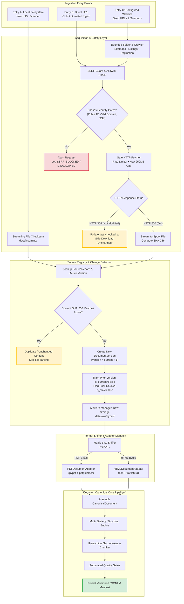

---

## 2. Website Discovery & Crawling Lifecycle

Shows how the bounded crawler traverses sitemaps, RSS feeds, and listing pages while respecting domain boundaries and pagination limits.

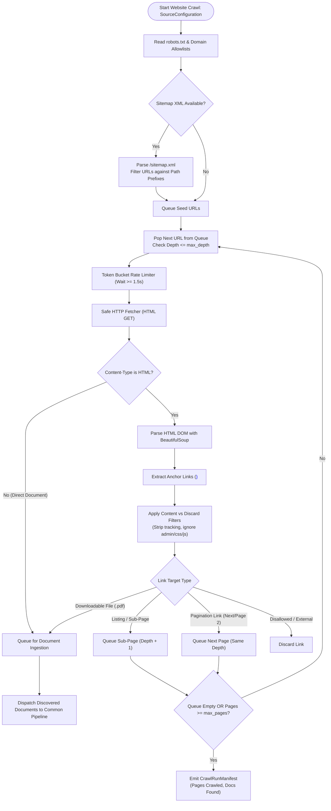

---

## 3. Safe HTTP Acquisition & SSRF Protection Sequence

Details the exact security checks performed on every network request before a single byte of body data is consumed.

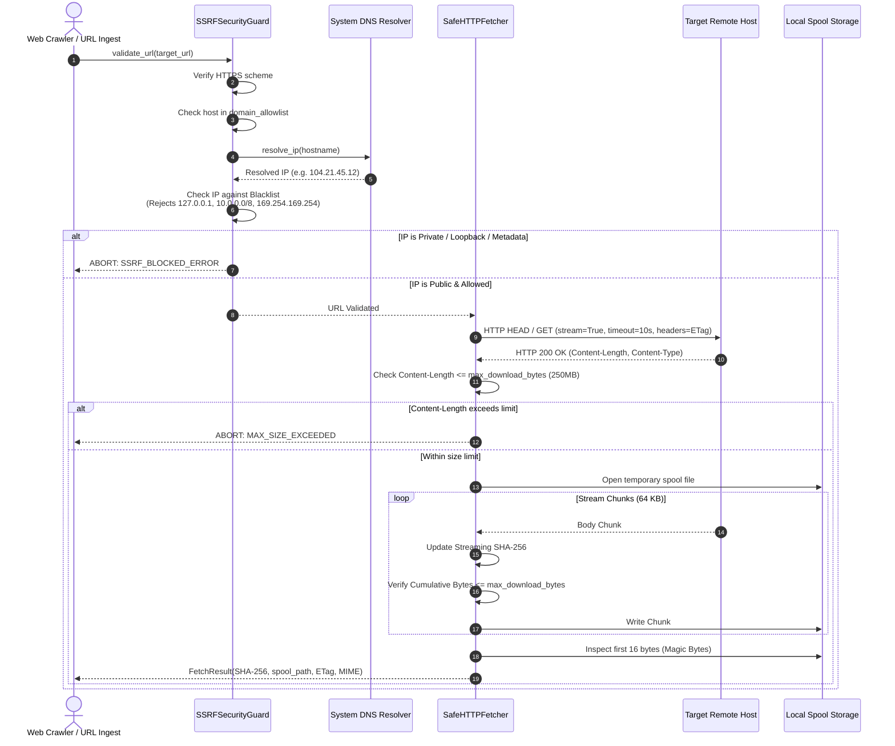

---

## 4. Incremental Change Detection & Version Lineage State Machine

Illustrates how the pipeline tracks versions, detects modifications, and manages stale chunks without deleting historical compliance records.

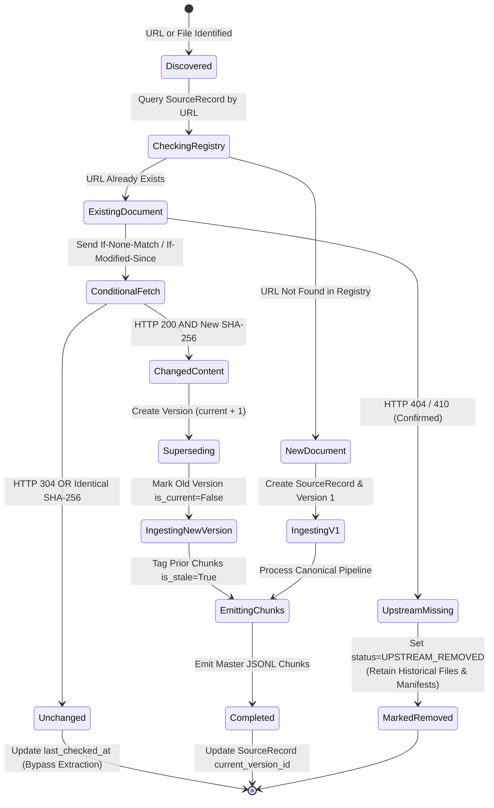

---

## 5. PDF Structural Inference Decision Tree

Illustrates the exact four-tier hierarchy used to determine section boundaries without hardcoded configurations or unvalidated assumptions.

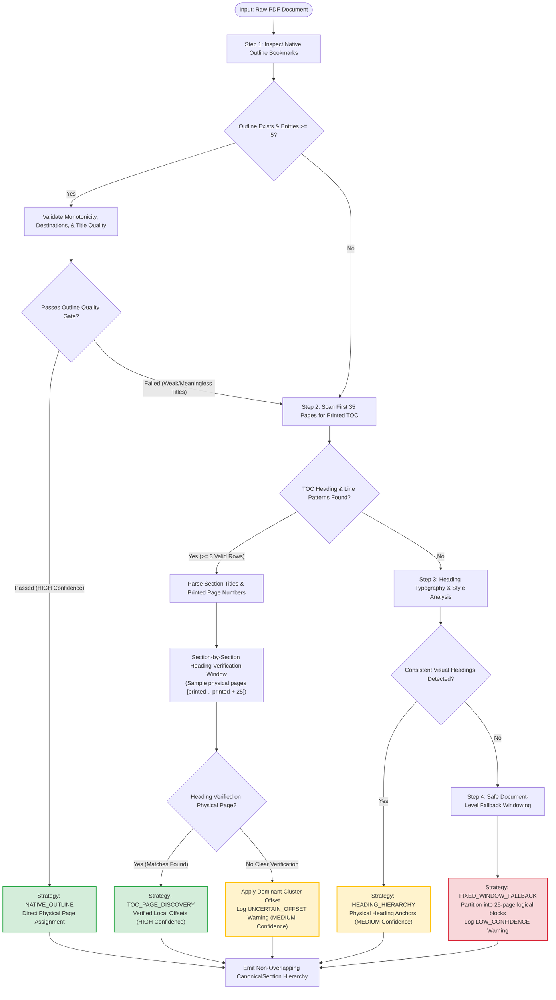

---

## 6. Table Extraction & Graceful Degradation Flow

Shows how financial tables are processed into markdown matrices, with automated detection and isolation of malformed cells.

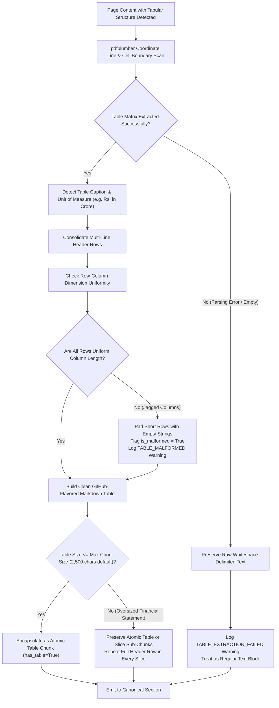

---

## 7. Component Sequence Interaction Across the Complete Pipeline

Traces execution across all modules during a scheduled crawl of an annual report website.

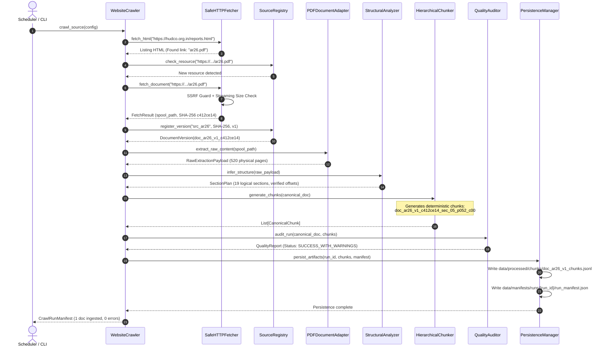

---

## 8. Layer 4 Indexing & Retrieval Flow

Illustrates how canonical chunks are loaded, linearized, indexed, filtered, and scored with dual-threshold calibrated abstention.

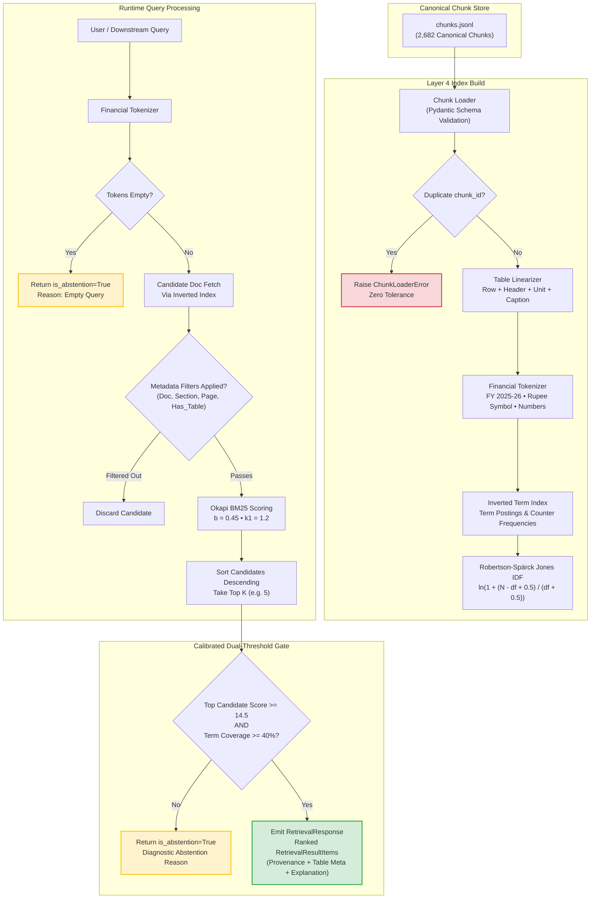

---

## 9. End-to-End Orchestration & Acceptance Gate Sequence

Traces execution of `EndToEndPipelineRunner` during automated scheduling sweeps.

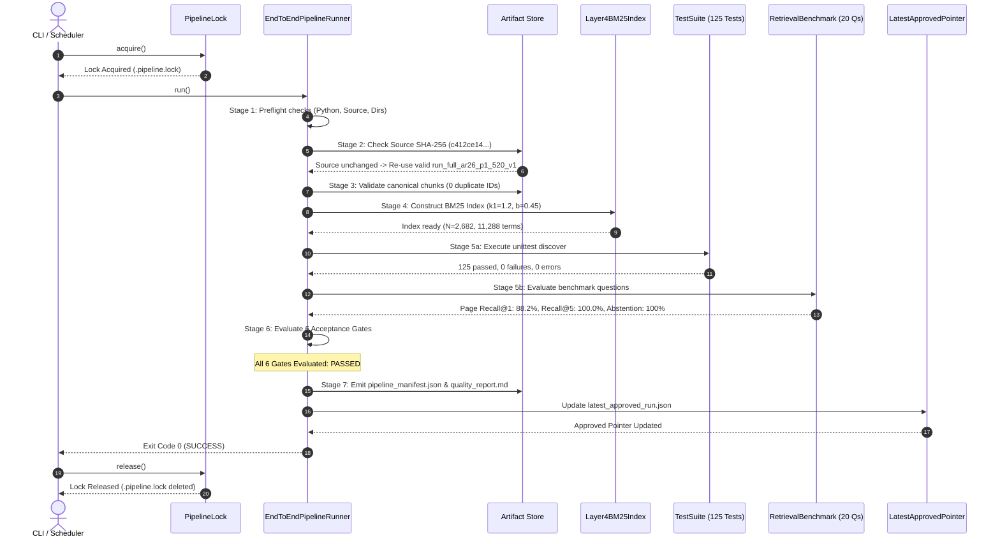

---

## 10. Multi-Report Corpus Ingestion & Strict Identity Gating Lifecycle

Traces the ingestion and verification pipeline implemented in `run_full_corpus_ingestion.py` across `ar15.pdf` through `ar26.pdf`.

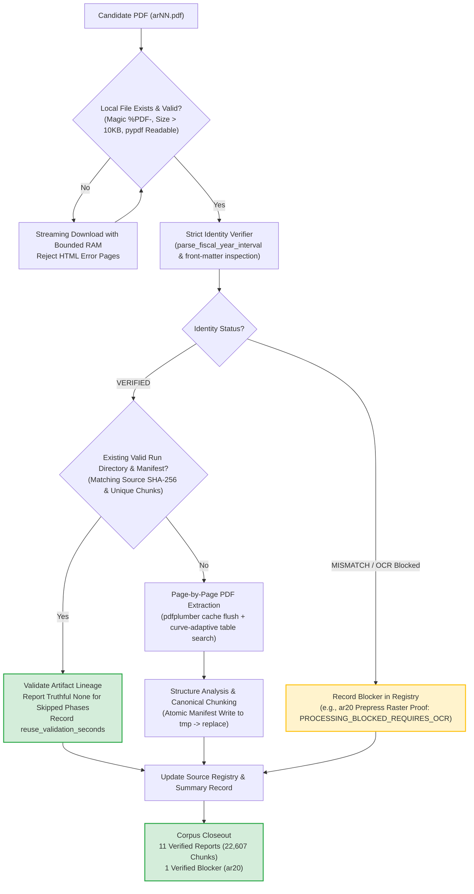

---

## 11. Persistent Semantic Vector Retrieval Lifecycle

Illustrates the vector indexing, incremental caching, and similarity search flow across canonical chunks.

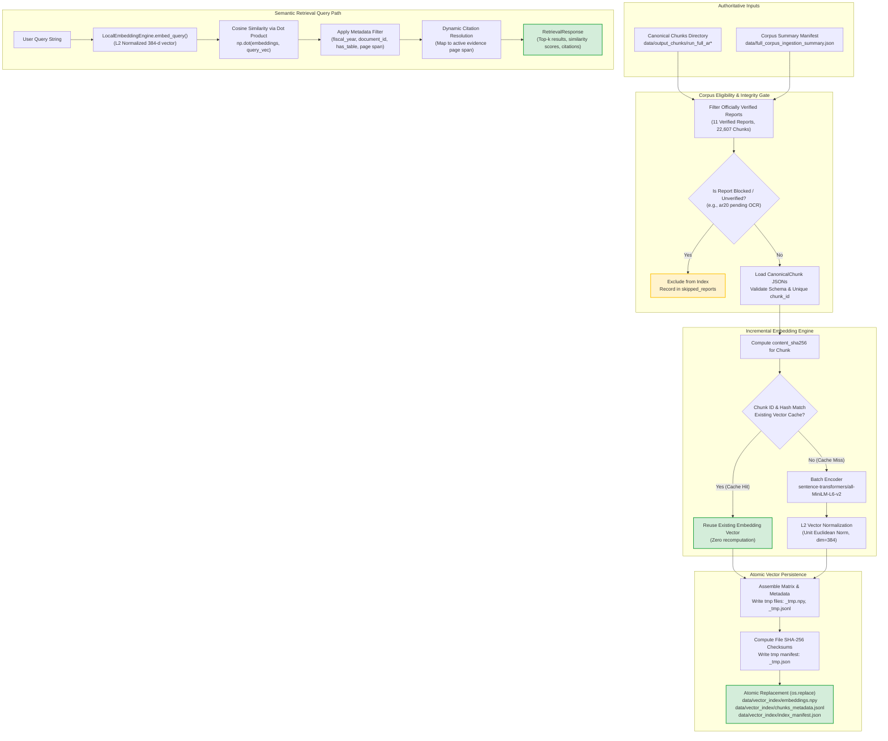

---

## 12. Hybrid BM25 + Semantic Retrieval Architecture (RRF Fusion)

Prompt 3 implements a unified hybrid retrieval layer that queries both the BM25 Okapi lexical index and the dense semantic vector index in parallel, fusing candidate rankings via Reciprocal Rank Fusion (RRF).

### 12.1 End-to-End Hybrid Flow Diagram

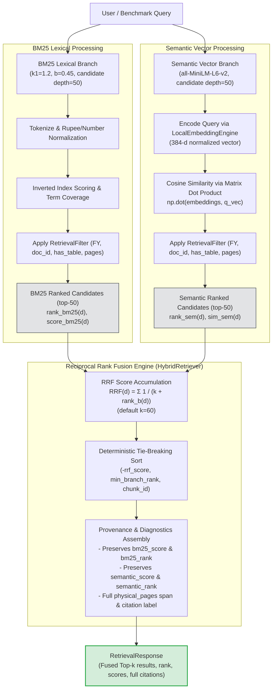

### 12.2 Mathematical Definition of RRF
For document $d$ and ranking branches $B \subseteq \{\text{bm25}, \text{semantic}\}$:
$$RRF(d) = \sum_{b \in B} \frac{1}{k + \text{rank}_b(d)}$$
Where:
- $k = 60$ (smoothing constant preventing top ranks from dominating).
- $\text{rank}_b(d) \in [1, \text{depth}_b]$ is the 1-based rank of document $d$ in branch $b$.
- If a candidate document is retrieved by only one branch, it receives contribution solely from that branch.
- Raw BM25 scores and cosine similarities are **never** summed directly; only ordinal rank signals are fused.

---

## 13. Local UI, Qwen Inference, and Observability Flow (Prompt 4)

Prompt 4 adds an interactive local diagnostic interface and integrates the existing local Qwen3-4B model running on an NVIDIA GeForce RTX 5060 Laptop GPU.

### 13.1 Query → Retrieval → Local Qwen → Cited Answer Flow

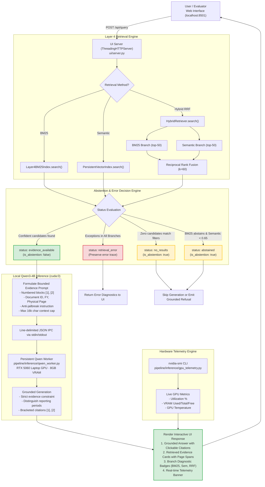

### 13.2 Outcome Status Classification Matrix

| Status Code | Conditions | Abstention Flag | Description |
|---|---|---|---|
| `evidence_available` | Confident candidates retrieved across active branches (BM25 score $\ge 14.5$ or Semantic score $\ge 0.65$). | `false` | Normal operation. Supporting chunks passed to Qwen for cited answering. |
| `abstained` | Candidates evaluated, but BM25 score $< 14.5$, term coverage $< 40\%$, and semantic similarity $< 0.65$. | `true` | Unanswerable or out-of-domain query. Hallucination safely suppressed. |
| `no_results` | Empty query, or no candidates matched the applied metadata filters. | `true` | No chunks available matching the requested report or criteria. |
| `partial_branch_failure` | One branch raised an exception (e.g. disk fault), but remaining branch returned valid candidates. | `false` | Degraded operation. Evidence from healthy branch is returned with failure noted. |
| `retrieval_error` | All active branches encountered runtime exceptions. | `false` | Index or runtime failure. Never classified as legitimate model abstention. |

