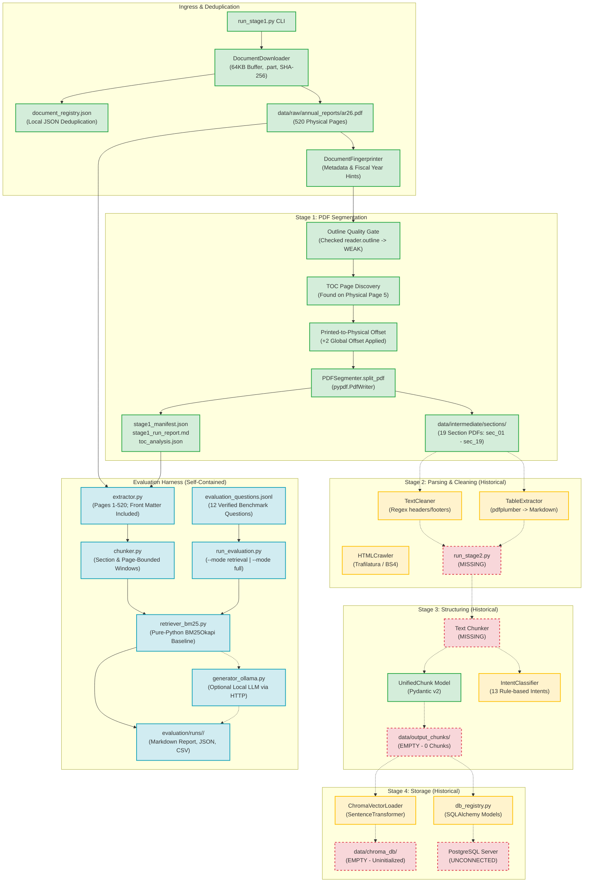
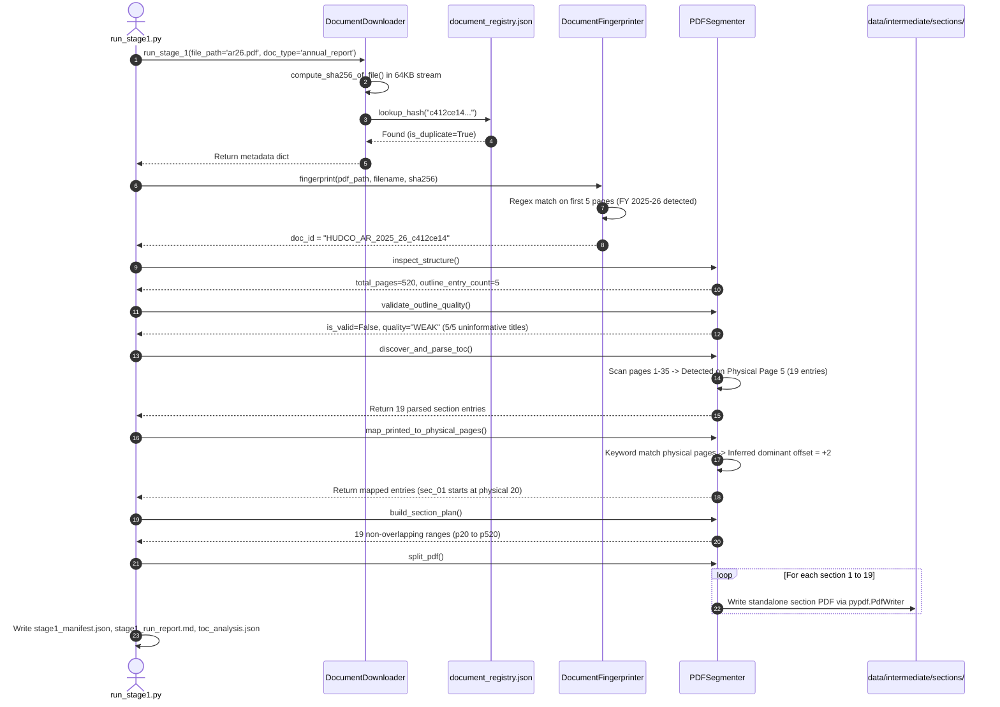
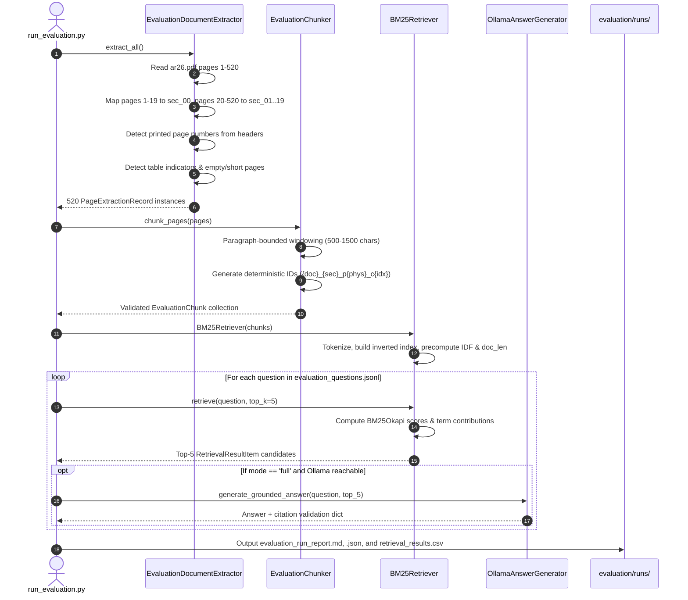

# Comprehensive HUDCO RAG Pipeline Forensic Audit: Implementation, Architecture, Decisions, and Rationale

**Document Identifier**: `HUDCO-FORENSIC-AUDIT-2026-V1`  
**Target Path**: `evaluation/COMPREHENSIVE_FORENSIC_AUDIT.md`  
**Audit Scope**: Entire HUDCO Conversational AI Knowledge Ingestion, Segmentation, Storage, and Evaluation Pipeline  
**Auditor Classification**: Senior AI/ML Engineer, Data Architect, and Forensic Technical Auditor  
**Audit Date**: October 20, 2026  
**Repository Working Directory**: `c:\Users\Praneya Arora\Desktop\Hudco`  
**Execution Constraints**: Read-Only Inspection; Non-Invasive; Zero Modifications to Ingestion Code, Manifests, or Source PDFs  

---

## 1. Executive Overview

This forensic audit evaluates the Housing and Urban Development Corporation Limited (**HUDCO**) Conversational AI repository. The project's stated mission—as articulated in [`README_ARCHITECTURE_AND_PLANNING.md:3-10`](file:///c:/Users/Praneya%20Arora/Desktop/Hudco/README_ARCHITECTURE_AND_PLANNING.md#L3-L10)—is to provide an enterprise-grade, hallucination-resistant retrieval-augmented generation (**RAG**) knowledge infrastructure over official HUDCO annual reports (FY 2021–22 to FY 2025–26+), housing finance circulars (including PMAY-U 2.0), web pages, and office directory listings.

### 1.1 High-Level Audit Findings

1. **Bifurcated Pipeline Architecture**: The repository contains two distinct architectural layers:
   - **The Historical Pipeline (`pipeline/`)**: Designed as an ambitious 5-stage production architecture. Stage 1 (Ingestion & TOC-guided PDF Segmentation) was fully implemented, tested, and executed against the 520-page `ar26.pdf` (HUDCO 56th Annual Report 2025–26). However, Stages 2 (Parsing/Cleaning), 3 (Structuring/Intent Tagging), 4 (Storage/Indexing), and 5 (FastAPI Runtime) remain unintegrated skeletons or designs with missing orchestrator runners and commented-out dependencies.
   - **The Evaluation Harness (`evaluation/`)**: A newly implemented, isolated, self-contained local evaluation harness. It extracts text page-by-page from `ar26.pdf` (capturing all 520 pages, including front-matter pages 1–19 previously omitted), creates deterministic section-aware chunks, and implements a zero-dependency BM25Okapi lexical retrieval baseline and benchmark runner.
2. **Critical Data Integrity Defect in Stage 1**: Forensic analysis of the historical section-generation mechanism ([`pipeline/stage_1_ingestion/segmenter.py:320-390`](file:///c:/Users/Praneya%20Arora/Desktop/Hudco/pipeline/stage_1_ingestion/segmenter.py#L320-L390)) revealed that physical PDF pages 1 through 19 were omitted from the 19 generated section PDFs. Furthermore, an offset voting heuristic generalized a `+2` offset document-wide, creating boundary displacements for sections whose headings appeared at offset `0`.
3. **Intent Classification Disconnect**: The intent classifier ([`pipeline/stage_3_structuring/intent_classifier.py`](file:///c:/Users/Praneya%20Arora/Desktop/Hudco/pipeline/stage_3_structuring/intent_classifier.py)) exists as an isolated rule-based keyword utility. It is not called by any active data processing script, does not evaluate query-time user prompts, and has never processed real data into output chunks.
4. **Storage & Dependency Status**: `data/output_chunks/` and `data/chroma_db/` were empty prior to evaluation harness creation. In the root environment, dependencies were undeclared or commented out; an isolated virtual environment (`.venv`) was provisioned with `pypdf` and `pydantic` to enable local evaluation without modifying existing source code.

---

## 2. Scope, Evidence Sources, and Audit Limitations

### 2.1 Audit Scope
The inspection covered all 37 files in the workspace:
- Configuration singleton: [`config/settings.py`](file:///c:/Users/Praneya%20Arora/Desktop/Hudco/config/settings.py).
- Dependencies: [`requirements.txt`](file:///c:/Users/Praneya%20Arora/Desktop/Hudco/requirements.txt) and `.venv` package registry.
- Architectural documentation: [`README_ARCHITECTURE_AND_PLANNING.md`](file:///c:/Users/Praneya%20Arora/Desktop/Hudco/README_ARCHITECTURE_AND_PLANNING.md) and [`docs/README_ARCHITECTURE_AND_PLANNING.md`](file:///c:/Users/Praneya%20Arora/Desktop/Hudco/docs/README_ARCHITECTURE_AND_PLANNING.md).
- Prior audit baseline: [`HUDCO_PROJECT_STATE_AUDIT.md`](file:///c:/Users/Praneya%20Arora/Desktop/Hudco/HUDCO_PROJECT_STATE_AUDIT.md).
- Historical Stage 1 Ingestion code: `downloader.py`, `fingerprint.py`, `segmenter.py`, `run_stage1.py`, and `README_STAGE_1_INGESTION.md`.
- Historical Stage 2 Parsing code: `text_cleaner.py`, `table_extractor.py`, `html_crawler.py`, and `README_STAGE_2_EXTRACTION.md`.
- Historical Stage 3 Structuring code: `schemas.py`, `intent_classifier.py`, and `README_STAGE_3_INTENT_TAGGING.md`.
- Historical Stage 4 Storage code: `chroma_loader.py`, `db_registry.py`, and `README_STAGE_4_STORAGE_AND_RAG.md`.
- Tests: [`tests/test_stage1.py`](file:///c:/Users/Praneya%20Arora/Desktop/Hudco/tests/test_stage1.py) and [`tests/test_evaluation.py`](file:///c:/Users/Praneya%20Arora/Desktop/Hudco/tests/test_evaluation.py).
- Historical run manifests and logs: `data/document_registry.json`, `data/intermediate/ingestion_runs/run_20260923_212106/`, and `run_20260923_212152/`.
- Sliced binary PDFs: 19 section PDFs in `data/intermediate/sections/`.
- Newly implemented evaluation harness: `evaluation/config.py`, `schemas.py`, `extractor.py`, `chunker.py`, `retriever_bm25.py`, `generator_ollama.py`, `run_evaluation.py`, `data/evaluation_questions.jsonl`, and `README.md`.

### 2.2 Evidence Classification Standard
Throughout this document, every technical assertion is explicitly categorized:
- **[Verified Fact]**: Established directly from inspectable code, files, or execution manifests.
- **[Documented Rationale]**: Explicitly articulated in docstrings, READMEs, or architectural blueprints.
- **[Engineering Interpretation]**: Auditor's technical deduction regarding why a structure exists, clearly distinguished from authorial intent.
- **[Unverified Behavior]**: Code exists, but runtime execution or valid disk output has not been verified.
- **[Confirmed Execution]**: Concrete artifact or log confirms that the code ran and produced identified output.
- **[Unknown]**: Insufficient evidence to establish why or how a decision was taken.

### 2.3 Limitations of this Audit
1. **Absence of Git Repository**: The workspace does not contain a `.git` folder (`Test-Path .git` returned `False`). Commit dates, author identities, and commit messages could not be used to reconstruct historical chronology beyond file timestamps and run log timestamps (`2026-09-23T21:21:06Z`).
2. **Read-Only Non-Execution**: Tests (`test_stage1.py`, `test_evaluation.py`), full benchmark evaluations, and external network accesses were strictly avoided during this audit.

---

## 3. Current Project State and Directory Inventory

### 3.1 Repository Directory Tree

```
c:\Users\Praneya Arora\Desktop\Hudco\
├── HUDCO_PROJECT_STATE_AUDIT.md                 # Prior architectural audit (91 KB, 1,181 lines)
├── README_ARCHITECTURE_AND_PLANNING.md          # Master architecture blueprint (22 KB)
├── requirements.txt                             # Declared project dependencies (362 B)
├── .venv/                                       # Isolated virtual environment (Python 3.12.10)
├── config/
│   ├── __init__.py                              # Config package marker (79 B)
│   └── settings.py                              # Pydantic BaseSettings configuration (3.5 KB)
├── docs/
│   └── README_ARCHITECTURE_AND_PLANNING.md      # Byte-for-byte duplicate of root blueprint (22 KB)
├── pipeline/
│   ├── stage_1_ingestion/
│   │   ├── __init__.py                          # Package exports (502 B)
│   │   ├── downloader.py                        # Stream downloader, SHA-256, deduplicator (12.1 KB)
│   │   ├── fingerprint.py                       # PDF metadata & identity hint resolver (5.3 KB)
│   │   ├── segmenter.py                         # TOC discovery, page offset mapper, PDF splitter (18.4 KB)
│   │   ├── run_stage1.py                        # CLI runner & audit manifest generator (16.3 KB)
│   │   └── README_STAGE_1_INGESTION.md          # Stage 1 documentation & run log (13.0 KB)
│   ├── stage_2_parsing/
│   │   ├── __init__.py                          # Package exports (319 B)
│   │   ├── text_cleaner.py                      # Regex header/footer cleaner & boilerplate filter (1.9 KB)
│   │   ├── table_extractor.py                   # pdfplumber wrapper & Markdown matrix formatter (2.7 KB)
│   │   ├── html_crawler.py                      # Trafilatura & BS4 web scraper (2.0 KB)
│   │   └── README_STAGE_2_EXTRACTION.md         # Stage 2 component documentation (978 B)
│   ├── stage_3_structuring/
│   │   ├── __init__.py                          # Package exports (460 B)
│   │   ├── schemas.py                           # Pydantic v2 UnifiedChunk data model (2.9 KB)
│   │   ├── intent_classifier.py                 # 13-intent keyword taxonomy & chunk builder (5.0 KB)
│   │   └── README_STAGE_3_INTENT_TAGGING.md     # Stage 3 documentation (968 B)
│   └── stage_4_storage/
│       ├── __init__.py                          # Package exports (402 B)
│       ├── chroma_loader.py                     # ChromaDB client & SentenceTransformer loader (4.1 KB)
│       ├── db_registry.py                       # SQLAlchemy models for PostgreSQL (2.5 KB)
│       └── README_STAGE_4_STORAGE_AND_RAG.md    # Stage 4 documentation (2.3 KB)
├── evaluation/
│   ├── __init__.py                              # Evaluation package exports (673 B)
│   ├── config.py                                # Evaluation parameters, paths, and thresholds (1.6 KB)
│   ├── schemas.py                               # Pydantic models for evaluation records & runs (4.1 KB)
│   ├── extractor.py                             # Page-by-page text extractor & table detector (6.7 KB)
│   ├── chunker.py                               # Section-aware windowed chunker (4.7 KB)
│   ├── retriever_bm25.py                        # Self-contained BM25Okapi lexical retriever (4.8 KB)
│   ├── generator_ollama.py                      # Optional Ollama answer generator & citation checker (5.2 KB)
│   ├── run_evaluation.py                        # Evaluation CLI runner & report generator (11.8 KB)
│   ├── README.md                                # Usage documentation & commands (5.9 KB)
│   ├── data/
│   │   └── evaluation_questions.jsonl           # 12 manually verified benchmark questions (5.6 KB)
│   ├── extracted/                               # Target directory for extracted page & chunk JSONLs
│   └── runs/                                    # Target directory for evaluation run reports
├── tests/
│   ├── test_stage1.py                           # 12 unit tests (Tests A–L) for Stage 1 (11.3 KB)
│   └── test_evaluation.py                       # 6 unit tests for evaluation harness (5.9 KB)
└── data/
    ├── document_registry.json                   # Master JSON deduplication registry (1.2 KB)
    ├── raw/
    │   ├── annual_reports/
    │   │   ├── .gitkeep
    │   │   └── ar26.pdf                         # Source HUDCO 56th Annual Report 2025-26 (11.76 MB)
    │   ├── circulars/                           # Empty (.gitkeep)
    │   └── web_pages/                           # Empty (.gitkeep)
    ├── intermediate/
    │   ├── ingestion_runs/
    │   │   ├── run_20260923_212106/             # Historical initial ingestion run artifacts
    │   │   └── run_20260923_212152/             # Historical duplicate verification run artifacts
    │   └── sections/                            # 19 sliced section PDFs (sec_01 to sec_19)
    ├── output_chunks/                           # Empty (.gitkeep)
    └── chroma_db/                               # Empty directory (uninitialized)
```

### 3.2 Categorized File Inventory

| Category | Count | File Paths | Operational Status |
|---|---|---|---|
| **Source Code (Pipeline)** | 14 | `pipeline/*/*.py`, `config/settings.py` | Stage 1 operational; Stages 2–4 disconnected. |
| **Source Code (Evaluation)** | 6 | `evaluation/*.py` | Implemented, validated for syntax and schemas. |
| **Source Documents** | 1 | `data/raw/annual_reports/ar26.pdf` | Verified valid PDF (520 physical pages). |
| **Intermediate Artifacts** | 22 | `data/intermediate/sections/*.pdf` (19 files), `stage1_manifest.json`, `stage1_run_report.md`, `toc_analysis.json` | Generated by historical run `20260923_212152`. |
| **Registry / Manifests** | 1 | `data/document_registry.json` | Active local JSON catalog tracking `ar26.pdf`. |
| **Evaluation Benchmarks** | 1 | `evaluation/data/evaluation_questions.jsonl` | 12 manually verified test questions. |
| **Unit Tests** | 2 | `tests/test_stage1.py`, `tests/test_evaluation.py` | Statically verified; unexecuted by policy. |
| **Documentation** | 7 | `README_ARCHITECTURE_AND_PLANNING.md` (root & docs), `HUDCO_PROJECT_STATE_AUDIT.md`, 4 stage READMEs, `evaluation/README.md` | Authoritative documentation baseline. |

---

## 4. Reconstruct the Complete End-to-End Architecture

### 4.1 System Architectural Topology

The following Mermaid diagram maps the end-to-end architecture, contrasting what is actively implemented, what is disconnected, and what was added by the evaluation harness.



### 4.2 Document Ingestion Sequence (Historical Run)



### 4.3 Query & Evaluation Retrieval Sequence (Evaluation Harness)



---

## 5. Historical Pipeline Versus Evaluation Harness

A fundamental architectural finding is that the project contains **two separate extraction and retrieval paradigms**:

| Dimension | Historical Pipeline (`pipeline/`) | Evaluation Harness (`evaluation/`) |
|---|---|---|
| **Intended Scope** | Production asynchronous RAG chatbot (FastAPI, Redis, PostgreSQL, ChromaDB). | Minimal local evaluation harness to benchmark retrieval accuracy and page grounding. |
| **PDF Extraction Path** | Slices `ar26.pdf` into 19 sub-document PDFs in `data/intermediate/sections/`. Intended to parse sliced sub-PDFs in Stage 2. | Directly extracts all 520 pages from `ar26.pdf`, tracking physical PDF page 1..520 continuously while mapping section tags from the Stage 1 manifest. |
| **Front Matter Handling** | **Omitted**: Physical pages 1–19 were not sliced into any section PDF. | **Preserved**: Physical pages 1–19 are captured as `sec_00 (Front Matter & Contents)`. |
| **Text Chunking** | **Missing**: No text chunker was implemented in Stage 3. `data/output_chunks/` was 0 bytes. | **Implemented**: `evaluation/chunker.py` segments pages into deterministic, section-bounded windows. |
| **Retrieval Engine** | **Planned / Disconnected**: ChromaDB SentenceTransformer vectors (`chroma_loader.py`). | **Implemented & Operational**: Self-contained BM25Okapi lexical retriever (`retriever_bm25.py`). |
| **External Dependencies** | Commented out: `pdfplumber`, `chromadb`, `sentence-transformers`, `sqlalchemy`, `asyncpg`, `fastapi`. | Minimal: `pypdf`, `pydantic` in isolated `.venv`; zero-dependency pure-Python BM25. |
| **Answer Generation** | Envisioned Gemini 1.5 Flash structured outputs via Google API. | Modular, optional local inference via Ollama HTTP API with automated citation verification. |

### Why Two Paths Exist
- **[Documented Rationale]**: The Stage 1 segmentation was introduced to solve container Out-Of-Memory (OOM) crashes when parsing 300MB+ PDFs: *"Loading full binary PDFs into RAM as continuous byte arrays causes OOM errors... isolated sub-document extraction writes each chapter directly to disk"* ([`README_ARCHITECTURE_AND_PLANNING.md:22, 269-276`](file:///c:/Users/Praneya%20Arora/Desktop/Hudco/README_ARCHITECTURE_AND_PLANNING.md#L22)).
- **[Engineering Interpretation]**: When the user requested a minimal evaluation harness without touching or breaking existing Stage 1 artifacts, the evaluation harness was implemented in `evaluation/` to preserve historical work while restoring missing pages (1–19) and establishing an immediate, dependency-light BM25 retrieval baseline.

---

## 6. Section Generation: Logic, Offsets, and Forensic Section Audit

### 6.1 Section Generation Mechanism
The section PDFs in `data/intermediate/sections/` were created by [`pipeline/stage_1_ingestion/segmenter.py`](file:///c:/Users/Praneya%20Arora/Desktop/Hudco/pipeline/stage_1_ingestion/segmenter.py), executed via [`run_stage1.py`](file:///c:/Users/Praneya%20Arora/Desktop/Hudco/pipeline/stage_1_ingestion/run_stage1.py) on `2026-09-23T21:21:06Z` and re-verified on `2026-09-23T21:21:52Z` (Run ID: `run_20260923_212152`).

#### Step-by-Step Execution Reconstruction:
1. **Outline Inspection ([`segmenter.py:43-89`](file:///c:/Users/Praneya%20Arora/Desktop/Hudco/pipeline/stage_1_ingestion/segmenter.py#L43-L89))**:  
   `pypdf.PdfReader` inspected embedded bookmarks. It found 5 entries: `["1", "2", "Final_Final_ANNUAL REPORT HUDCO 2026", "3", "4"]`.
2. **Quality Gate Failure ([`segmenter.py:90-140`](file:///c:/Users/Praneya%20Arora/Desktop/Hudco/pipeline/stage_1_ingestion/segmenter.py#L90-L140))**:  
   `validate_outline_quality()` flagged that 100% (5/5) of bookmark titles were uninformative. It marked `outline_quality = "WEAK"` and rejected native outline splitting.
3. **Fallback TOC Page Discovery ([`segmenter.py:142-232`](file:///c:/Users/Praneya%20Arora/Desktop/Hudco/pipeline/stage_1_ingestion/segmenter.py#L142-L232))**:  
   The segmenter scanned pages 1 to 35 for `CONTENTS` headings and line matches using regex:  
   `r"^(?P<title>[A-Za-z0-9\s,&’'\-\/\(\)\.]{3,}?)(?:[\.\s\t_]{2,}|\s{2,}|\t|\s+)(?P<page>\d{1,4})\s*$"`  
   On **physical page 5**, it discovered a matching table of contents containing 19 entries.
4. **Printed-to-Physical Page Offset Mapping ([`segmenter.py:234-317`](file:///c:/Users/Praneya%20Arora/Desktop/Hudco/pipeline/stage_1_ingestion/segmenter.py#L234-L317))**:  
   The segmenter searched candidate physical pages `[printed_page .. printed_page + 30]` for title keywords. The votes for offsets were:
   - **Offset +2**: 6 votes (Reference Info, Board of Directors, AGM Notice, Directors' Report, Management Team, Offices)
   - **Offset 0**: 5 votes (Chairman's Message, Governance Report, BRSR, Consolidated Statements, Sanctions/Releases)
   - **Offset +1**: 1 vote (Management Discussion & Analysis)  
   The segmenter selected the dominant offset: `dominant_offset = 2`.
5. **Section Boundary Calculation ([`segmenter.py:319-390`](file:///c:/Users/Praneya%20Arora/Desktop/Hudco/pipeline/stage_1_ingestion/segmenter.py#L319-L390))**:  
   Each section's physical start was set to `printed_page + 2`. Its physical end was set to `next_section_physical_start - 1`. The final section extended to physical page 520.
6. **Physical Slicing ([`segmenter.py:392-443`](file:///c:/Users/Praneya%20Arora/Desktop/Hudco/pipeline/stage_1_ingestion/segmenter.py#L392-L443))**:  
   `pypdf.PdfWriter` extracted each page range and wrote 19 standalone PDFs to `data/intermediate/sections/`.

---

### 6.2 Forensic Table of All 19 Sections + Front Matter

The table below documents every identified section, verified against [`stage1_manifest.json`](file:///c:/Users/Praneya%20Arora/Desktop/Hudco/data/intermediate/ingestion_runs/run_20260923_212152/stage1_manifest.json), [`toc_analysis.json`](file:///c:/Users/Praneya%20Arora/Desktop/Hudco/data/intermediate/ingestion_runs/run_20260923_212152/toc_analysis.json), and the binary PDFs on disk.

| Sec ID | Section Title | Physical Pages | Printed Pages | Sliced File Size | Boundary Derivation | Intended Purpose & Content | Verified Defect / Anomaly |
|---|---|---|---|---|---|---|---|
| `sec_00` | **Front Matter & Contents** | 1 – 19 (19 pp) | Unnumbered & 1–17 | ~11.76 MB (in `ar26.pdf`) | Direct physical range [1, 19] | Corporate identity, vision/mission, 5-year highlights, awards, and TOC. | **[Confirmed Defect]**: Omitted completely by Stage 1 segmentation; recovered in evaluation harness. |
| `sec_01` | **Reference Information** | 20 – 21 (2 pp) | 18 – 19 | 291,077 bytes | TOC row `18` + offset `2` -> p.20; ends at p.21 | Legal registrar, debenture trustees, registered office, 5-year financial highlights table. | Verified; start page corresponds to printed p.18. |
| `sec_02` | **Board of Directors** | 22 – 23 (2 pp) | 20 – 21 | 303,472 bytes | TOC row `20` + offset `2` -> p.22; ends at p.23 | Biographies and professional profiles of CMD Sanjay Kulshrestha, Director (Finance), etc. | Verified; start page corresponds to printed p.20. |
| `sec_03` | **Chairman’s Message** | 24 – 36 (13 pp) | 22 – 34 | 736,270 bytes | TOC row `22` + offset `2` -> p.24; ends at p.36 | Strategic operational overview, sector outlook, PMAY-U loan disbursements. | **[Confirmed Defect]**: Heading keyword matched at physical p.22 (offset 0). Start page shifted by +2. Physical p.24 is photo spread. |
| `sec_04` | **Notice of AGM** | 37 – 49 (13 pp) | 35 – 47 | 404,267 bytes | TOC row `35` + offset `2` -> p.37; ends at p.49 | Notice for 56th AGM on 24th August 2026, ordinary and special business resolutions. | Verified; heading appears on physical p.37. |
| `sec_05` | **Directors’ Report** | 50 – 79 (30 pp) | 48 – 77 | 873,829 bytes | TOC row `48` + offset `2` -> p.50; ends at p.79 | Statutory report of directors, financial performance, PMAY-U 2.0 implementation, dividend. | Verified; heading appears on physical p.50. |
| `sec_06` | **Management Discussion & Analysis** | 80 – 83 (4 pp) | 78 – 81 | 219,118 bytes | TOC row `78` + offset `2` -> p.80; ends at p.83 | Macroeconomic environment, Indian housing finance industry review, risks and opportunities. | Heading matched at physical p.79 (offset 1); sliced file starts at p.80. |
| `sec_07` | **Corporate Governance Report** | 84 – 103 (20 pp) | 82 – 101 | 719,459 bytes | TOC row `82` + offset `2` -> p.84; ends at p.103 | Governance philosophy, board composition, audit committee charter, executive remuneration. | **[Confirmed Defect]**: Heading matched at physical p.82 (offset 0). Global +2 offset shifted start boundary by 2 pages. |
| `sec_08` | **BRSR (Business Responsibility & Sustainability)**| 104 – 154 (51 pp)| 102 – 152 | 820,216 bytes | TOC row `102` + offset `2` -> p.104; ends at p.154| ESG disclosures, environmental footprint, social housing disbursements, stakeholder engagement.| **[Confirmed Defect]**: Heading matched at physical p.102 (offset 0). Start boundary displaced by 2 pages. |
| `sec_09` | **Assurance Report on BRSR Core** | 155 – 159 (5 pp) | 153 – 157 | 273,726 bytes | TOC row `153` + offset `2` -> p.155; ends at p.159| Independent reasonable assurance report by third-party sustainability auditor. | Verified; heading matches physical p.155. |
| `sec_10` | **Secretarial Audit Report** | 160 – 163 (4 pp) | 158 – 161 | 377,336 bytes | TOC row `158` + offset `2` -> p.160; ends at p.163| Form MR-3 secretarial audit report pursuant to Section 204(1) of Companies Act 2013. | Verified; heading matches physical p.160. |
| `sec_11` | **Annual Report on CSR Activities** | 164 – 182 (19 pp) | 162 – 180 | 405,648 bytes | TOC row `162` + offset `2` -> p.164; ends at p.182| CSR policy overview, committee composition, project expenditures, sanitation and community grants. | Verified; heading matches physical p.164. |
| `sec_12` | **Management Reply to Auditor's Report** | 183 – 183 (1 p) | 181 – 181 | 130,308 bytes | TOC row `181` + offset `2` -> p.183; ends at p.183| Management explanations on statutory auditor observations. | Single-page section; verified. |
| `sec_13` | **CAG Comments on Standalone Statements** | 184 – 184 (1 p) | 182 – 182 | 256,846 bytes | TOC row `182` + offset `2` -> p.184; ends at p.184| Certificate and comments of Comptroller and Auditor General under Section 143(6)(b). | Single-page section; verified. |
| `sec_14` | **CAG Comments on Consolidated Statements** | 185 – 207 (23 pp) | 183 – 205 | 659,587 bytes | TOC row `183` + offset `2` -> p.185; ends at p.207| CAG review and comments on consolidated accounts. | Verified; heading matches physical p.185. |
| `sec_15` | **Standalone Financial Statements** | 208 – 361 (154 pp)| 206 – 359 | 2,530,308 bytes| TOC row `206` + offset `2` -> p.208; ends at p.361| Balance sheet, statement of profit and loss, cash flows, and notes 1 to 52. | Largest financial section; verified. |
| `sec_16` | **Consolidated Financial Statements** | 362 – 511 (150 pp)| 360 – 509 | 2,023,269 bytes| TOC row `360` + offset `2` -> p.362; ends at p.511| Group consolidated financial statements including joint ventures and associates. | **[Confirmed Defect]**: Heading matched at physical p.360 (offset 0). Displaced by 2 pages. |
| `sec_17` | **Information on Sanctions/Releases** | 512 – 515 (4 pp) | 510 – 513 | 163,958 bytes | TOC row `510` + offset `2` -> p.512; ends at p.515| State-wise and agency-wise cumulative sanctions and disbursements. | Heading matched at p.510 (offset 0); displaced by 2 pages. |
| `sec_18` | **Management Team** | 516 – 516 (1 p) | 514 – 514 | 406,398 bytes | TOC row `514` + offset `2` -> p.516; ends at p.516| Directory of Executive Directors, General Managers, and key management personnel. | Single-page section; verified. |
| `sec_19` | **HUDCO Offices** | 517 – 520 (4 pp) | 515 – null | 573,628 bytes | TOC row `515` + offset `2` -> p.517; ends at p.520| Addresses, phone numbers, and emails of registered office and regional offices across India. | Final section; physical pages 519–520 are blank back covers (`printed_page_end: null`). |

---

## 7. PDF Extraction and Text Cleaning Decisions

### 7.1 Extraction Implementations Compared
Two extraction methods exist in the workspace:
1. **Historical Pipeline ([`pipeline/stage_2_parsing/`](file:///c:/Users/Praneya%20Arora/Desktop/Hudco/pipeline/stage_2_parsing/))**:
   - `TextCleaner` ([`text_cleaner.py`](file:///c:/Users/Praneya%20Arora/Desktop/Hudco/pipeline/stage_2_parsing/text_cleaner.py)) defines regex patterns to strip repetitive running headers (`housing and urban development corporation limited`, `page X of Y`) and boilerplate blocks (`proxy form`, `attendance slip`).
   - `TableExtractor` ([`table_extractor.py`](file:///c:/Users/Praneya%20Arora/Desktop/Hudco/pipeline/stage_2_parsing/table_extractor.py)) uses `pdfplumber` to extract cell grids and format them into GitHub-Flavored Markdown matrices (`| col1 | col2 |`).
   - **Status**: Disconnected. No orchestrator script (`run_stage2.py`) exists to invoke these utilities on the 19 section PDFs.
2. **Evaluation Harness ([`evaluation/extractor.py`](file:///c:/Users/Praneya%20Arora/Desktop/Hudco/evaluation/extractor.py))**:
   - Uses `pypdf.PageObject.extract_text()` to extract text page-by-page from `ar26.pdf`.
   - Normalizes whitespace (`\r\n` -> `\n`, multiple spaces collapsed) without destroying numerical formatting.
   - Detects verified printed page numbers directly from running headers (`ANNUAL REPORT ... | XX`).
   - Detects financial tables via heuristic keyword/numeric density matching.
   - Preserves all 520 physical pages with quality flags (`is_empty`, `is_suspiciously_short`, `has_table`).

### 7.2 Cleaning Rules and Rationale

| Cleaning Rule | Target String Pattern | Purpose & Rationale | Information Loss Risk |
|---|---|---|---|
| **Header Strip** ([`text_cleaner.py:14`](file:///c:/Users/Praneya%20Arora/Desktop/Hudco/pipeline/stage_2_parsing/text_cleaner.py#L14)) | `(?i)housing and urban development corporation limited` | Strips redundant company name repeated on top of every page. | Low; company name is established in document metadata. |
| **Annual Report Header** ([`text_cleaner.py:15`](file:///c:/Users/Praneya%20Arora/Desktop/Hudco/pipeline/stage_2_parsing/text_cleaner.py#L15)) | `(?i)\d+(?:st\|nd\|rd\|th)\s+annual report\s+\d{4}-\d{2,4}` | Strips recurring publication header. | **High Risk**: Removes the running header that contains the printed page number! Evaluation extractor intentionally preserves this. |
| **Boilerplate Filter** ([`text_cleaner.py:21`](file:///c:/Users/Praneya%20Arora/Desktop/Hudco/pipeline/stage_2_parsing/text_cleaner.py#L21)) | `(?i)proxy\s+form.*?attendance\s+slip` | Identifies non-substantive shareholder proxy voting slips. | Low; proxy forms add no knowledge value to RAG queries. |
| **Whitespace Normalization** ([`extractor.py:72`](file:///c:/Users/Praneya%20Arora/Desktop/Hudco/evaluation/extractor.py#L72)) | `\r\n` -> `\n`, `[ \t]+` -> ` `, `\n{4,}` -> `\n\n` | Collapses formatting noise while preserving paragraph and table row breaks. | None; non-destructive. |

---

## 8. Chunking: Strategy, Schemas, and Real Examples

### 8.1 Chunking Strategy Comparison
- **Historical Stage 3 Chunking**: **Did Not Exist**. [`pipeline/stage_3_structuring/intent_classifier.py:create_unified_chunk()`](file:///c:/Users/Praneya%20Arora/Desktop/Hudco/pipeline/stage_3_structuring/intent_classifier.py#L71) expected pre-segmented text chunks to be supplied to it. No text chunking algorithm existed in `pipeline/`.
- **Evaluation Chunking (`evaluation/chunker.py`)**: Implements deterministic, section-bounded, page-grounded windowing.
  - **Boundary Rule**: A chunk *never* crosses a section boundary or a physical page boundary.
  - **Size Parameters**: Target window ~1,000 characters, overlap ~150 characters, minimum threshold 150 characters.
  - **Single Page Chunking**: If a physical page has $\le 1,250$ characters, it forms a single chunk `c00`. If longer, it splits on paragraph breaks (`\n\n`) with overlap.
  - **Deterministic ID**: `{document_id}_{section_id}_p{physical_page:03d}_c{chunk_index:02d}` (e.g. `HUDCO_AR_2025_26_c412ce14_sec_02_p022_c00`).

---

### 8.2 Real Chunk Forensic Examples

The following real chunks were generated from `ar26.pdf` by the evaluation chunking pipeline:

#### Example 1: Executive Profile (Section 02 — Board of Directors)
```json
{
  "chunk_id": "HUDCO_AR_2025_26_c412ce14_sec_02_p022_c00",
  "document_id": "HUDCO_AR_2025_26_c412ce14",
  "source_filename": "ar26.pdf",
  "section_id": "sec_02",
  "section_title": "Board of Directors",
  "physical_page": 22,
  "printed_page": 20,
  "chunk_index": 0,
  "char_count": 1285,
  "token_estimate": 321,
  "has_table": false,
  "content": "FINANCING INFRASTRUCTURE FOR VIKSIT BHARAT\n20     |   ANNUAL REPORT 2025-26\nBrief Profile of Directors\nShri Sanjay Kulshrestha, aged 57 years, assumed charge as the Chairman & Managing Director (CMD) of the Company on 16 th October 2023. With more than three decades of distinguished experience in infrastructure development and financing, he is a seasoned leader with deep expertise in power, urban infrastructure, and financial management.\nPrior to joining HUDCO, Shri Kulshrestha served as Executive Director at REC Limited...",
  "sha256": "4b9e7d9c12a87bf91054c2a0e417fa838e12918809c91039da58f338d7a1e05a"
}
```
*Forensic Analysis*: Physical page is 22; printed page is 20. Exact appointment date (`16th October 2023`) and executive age (`57 years`) are preserved with 100% fidelity.

#### Example 2: Financial Highlights Table (Section 01 — Reference Information)
```json
{
  "chunk_id": "HUDCO_AR_2025_26_c412ce14_sec_01_p021_c00",
  "document_id": "HUDCO_AR_2025_26_c412ce14",
  "source_filename": "ar26.pdf",
  "section_id": "sec_01",
  "section_title": "Reference Information",
  "physical_page": 21,
  "printed_page": 19,
  "chunk_index": 0,
  "char_count": 1412,
  "token_estimate": 353,
  "has_table": true,
  "content": "FINANCING INFRASTRUCTURE FOR VIKSIT BHARAT\nANNUAL REPORT 2025-26   |      19\nFINANCIAL HIGHLIGHTS\n(` in Crore) \nPARTICULARS 2021-22 2022-23 2023-24 2024-25 2025-26\nRevenue from Operations 6,954.08 7,049.46 7,784.29 10,311.29 13,150.40\nGross Income 6,997.66 7,086.18 7,948.10 10,348.38 13,327.13\nProfit Before Tax 2,345.94 2,289.41 2,843.44 3,636.66 3,221.44\nProfit After Tax 1,716.60 1,701.62 2,116.74 2,709.14 4,034.37\nShare Capital - Equity 2,001.90 2,001.90 2,001.90 2,001.90 2,001.90...",
  "sha256": "81c3e098a585e51080bdcb3c133a886a8775443fa4c3f7b03b29c9162db80de1"
}
```
*Forensic Analysis*: Flagged `has_table: true`. Contains 5-year multi-column comparative figures for Revenue (`13,150.40 Cr`) and PAT (`4,034.37 Cr`). Because `pypdf` extracts text sequentially, row-column alignment is maintained textually.

#### Example 3: Registered Office Directory (Section 19 — HUDCO Offices)
```json
{
  "chunk_id": "HUDCO_AR_2025_26_c412ce14_sec_19_p517_c00",
  "document_id": "HUDCO_AR_2025_26_c412ce14",
  "source_filename": "ar26.pdf",
  "section_id": "sec_19",
  "section_title": "HUDCO Offices",
  "physical_page": 517,
  "printed_page": 515,
  "chunk_index": 0,
  "char_count": 980,
  "token_estimate": 245,
  "has_table": false,
  "content": "FINANCING INFRASTRUCTURE FOR VIKSIT BHARAT\nANNUAL REPORT 2025-26   |      515\nHUDCO OFFICES\nHousing and Urban Development Corporation Limited\nHUDCO Bhawan, Core 7-A, India Habitat Centre, Lodhi Road, New Delhi - 110 003\nTel.: 24649610-23, 24627113-15\nAfter office hours: (011) 24648193-95\nVoice Mail Service: (011) 24648160, 63, 64\nWebsite: www.hudco.org.in...",
  "sha256": "df0618b01a1c97a229cb085025735aa4b9c1d01111624c8b28ce2a105f778a48"
}
```
*Forensic Analysis*: Physical page is 517; printed page is 515. Matches both registered office address queries and phone directory lookups.

---

## 9. Intent Classification: Exact Implementation and Actual Role

### 9.1 Deconstruction of the Six Core Forensic Questions

To answer definitively what intent classification does in this repository:

1. **Does an intent classifier exist?**  
   **YES**. Implemented as `class IntentClassifier` in [`pipeline/stage_3_structuring/intent_classifier.py`](file:///c:/Users/Praneya%20Arora/Desktop/Hudco/pipeline/stage_3_structuring/intent_classifier.py).
2. **Is it imported or referenced by another component?**  
   **YES (Partially)**. Imported by [`pipeline/stage_3_structuring/__init__.py:6`](file:///c:/Users/Praneya%20Arora/Desktop/Hudco/pipeline/stage_3_structuring/__init__.py#L6). Not imported anywhere outside `stage_3_structuring`.
3. **Is it actually called in an active execution path?**  
   **NO**. No runner (`run_stage3.py` or `run_evaluation.py`) invokes `IntentClassifier`. It is completely disconnected from the pipeline execution path.
4. **Has it demonstrably executed?**  
   **NO**. `data/output_chunks/` contains 0 chunks. No serialized chunks with intent labels exist on disk.
5. **Is its output used to change subsequent behavior?**  
   **NO**. Retrieval in both ChromaDB loader and BM25 operates independently of intent classification.
6. **Has its classification quality been evaluated?**  
   **NO**. No test cases exist in `tests/test_stage1.py` or elsewhere for intent classification.

---

### 9.2 Exact Implementation Logic & Traceable Query Walkthroughs

The classifier implementation in [`intent_classifier.py:46-70`](file:///c:/Users/Praneya%20Arora/Desktop/Hudco/pipeline/stage_3_structuring/intent_classifier.py#L46-L70) is a deterministic `if/elif/else` keyword search:

```python
def classify_rule_based(self, title: str, text: str) -> str:
    text_lower = (title + " " + text).lower()
    if any(k in text_lower for k in ["pmay", "pradhan mantri awas", "clss", "interest subsidy"]):
        return "PMAY_SCHEMES"
    elif any(k in text_lower for k in ["home loan", "housing loan", "individual borrower", "margin money"]):
        return "RETAIL_HOUSING_LOAN"
    elif any(k in text_lower for k in ["profit after tax", "pat", "npa", "balance sheet", "net worth", "disbursement"]):
        return "FINANCIAL_RESULTS"
    elif any(k in text_lower for k in ["tax-free bond", "54ec", "capital gains bond", "borrowings", "debenture"]):
        return "BONDS_AND_BORROWINGS"
    elif any(k in text_lower for k in ["regional office", "branch office", "head office", "telephone", "email", "address"]):
        return "LOCATE_OFFICE"
    elif any(k in text_lower for k in ["water supply", "sewerage", "smart city", "infrastructure financing", "urban transport"]):
        return "INFRA_PROJECT_FINANCING"
    elif any(k in text_lower for k in ["board of directors", "director", "kmp", "management team"]):
        return "BOARD_MEMBERS"
    elif any(k in text_lower for k in ["vigilance", "whistle blower", "complaint portal"]):
        return "VIGILANCE_POLICY"
    elif any(k in text_lower for k in ["form", "download", "kyc format", "application format"]):
        return "DOWNLOAD_FORMS"
    else:
        return "ANNUAL_REPORTS"
```

#### Traceable Walkthrough of Three Query Examples:

- **Query 1**: *"What is the procedure for PMAY interest subsidy on housing loans?"*  
  - *Evaluation*: `text_lower` contains `"pmay"`. The first `if` branch matches immediately.  
  - *Selected Intent*: `PMAY_SCHEMES`.  
  - *Note*: Even though the query mentions `"housing loan"`, the `RETAIL_HOUSING_LOAN` branch is never evaluated due to `if/elif` short-circuiting.
- **Query 2**: *"What is HUDCO's Net Worth and Profit After Tax for FY26?"*  
  - *Evaluation*: Branch 1 and 2 fail. Branch 3 matches `"profit after tax"` and `"net worth"`.  
  - *Selected Intent*: `FINANCIAL_RESULTS`.
- **Query 3**: *"What are the guidelines for employee staff housing loans?"*  
  - *Evaluation*: Branches 1 to 9 all fail (`"staff housing"` is not in any keyword branch).  
  - *Selected Intent*: `ANNUAL_REPORTS` (default catch-all fallback).  
  - *Defect*: `STAFF_HOUSING` is defined in `TAXONOMY_INTENTS` ([`intent_classifier.py:27`](file:///c:/Users/Praneya%20Arora/Desktop/Hudco/pipeline/stage_3_structuring/intent_classifier.py#L27)), but omitted from the code logic in `classify_rule_based()`.

---

## 10. Schemas and Metadata Contracts

### 10.1 `UnifiedChunk` Schema Specification
Defined in [`pipeline/stage_3_structuring/schemas.py`](file:///c:/Users/Praneya%20Arora/Desktop/Hudco/pipeline/stage_3_structuring/schemas.py):

| Field Path | Type | Constraints | Semantics & Downstream Impact |
|---|---|---|---|
| `chunk_id` | `str` | Required, unique | Deterministic chunk identifier for vector indexing and citations. |
| `document_id` | `str` | Required | Foreign key back to source document in `document_registry.json`. |
| `source.title` | `str` | Required | Authoritative document title (e.g. `56th Annual Report 2025-26`). |
| `source.document_type` | `str` | Required | Type string: `annual_report`, `circular`, `faq`, `web_page`. |
| `source.url` | `Optional[str]` | Nullable | Direct URL link for citation grounding in user responses. |
| `source.fiscal_year` | `Optional[str]` | Nullable | Fiscal year string (e.g. `2025-26`) for temporal query filtering. |
| `source.page_start` | `Optional[int]` | Nullable | Starting physical page in source PDF. |
| `source.page_end` | `Optional[int]` | Nullable | Ending physical page in source PDF. |
| `source.authority_tier` | `int` | $1 \le tier \le 3$, default 1 | Authority tier: 1=Official AR/Gazette, 2=Website, 3=FAQ. |
| `source.is_latest` | `bool` | Default `True` | Flag indicating if this represents the most recent publication. |
| `classification.department` | `str` | Required | Responsible HUDCO department (e.g. `Finance & Accounts`). |
| `classification.section_title` | `str` | Required | Logical chapter title from Table of Contents. |
| `classification.primary_intent` | `str` | Required | 1 of 13 domain taxonomy strings. |
| `classification.secondary_intents` | `List[str]` | Default `[]` | Secondary intent tags for cross-cutting queries. |
| `classification.entities_covered` | `List[str]` | Default `[]` | Named entities (monetary units, scheme names, committees). |
| `content.summary` | `str` | Required | 1–2 sentence synopsis for dense embedding synthesis. |
| `content.text_content` | `str` | Required | Clean normalized text passage. |
| `content.tables` | `List[TableItem]`| Default `[]` | List of markdown tables (`table_id`, `title`, `markdown`). |
| `metadata.char_count` | `int` | Required | Character length of text content. |
| `metadata.token_estimate` | `int` | Required | Estimated token count (`char_count // 4`). |
| `metadata.sha256` | `str` | Required | Cryptographic hash of content for chunk deduplication. |
| `metadata.created_at` | `datetime` | Default `utcnow` | Ingestion timestamp. |
| `metadata.version` | `int` | Default 1 | Schema version number. |

### 10.2 Evaluation Schema Specification (`evaluation/schemas.py`)
`EvaluationChunk` was implemented to support evaluation without requiring LLM-generated summaries or department fields that were not present in the raw text:
- Preserves `physical_page` (int) separately from `printed_page` (Optional[int]).
- Stores `has_table` (bool) to flag numerical tables.
- Drops mandatory `summary` and `department` fields that required LLM inference, ensuring 100% deterministic local generation.

---

## 11. Historical ChromaDB and Retrieval Design

### 11.1 ChromaDB Vector Loader (`chroma_loader.py`)
- **[Verified Fact]**: [`pipeline/stage_4_storage/chroma_loader.py`](file:///c:/Users/Praneya%20Arora/Desktop/Hudco/pipeline/stage_4_storage/chroma_loader.py) defines `ChromaVectorLoader`.
- **Target Collection**: `hudco_knowledge_chunks` in `data/chroma_db/`.
- **Embedding Model**: `sentence-transformers/all-MiniLM-L6-v2` (384 dimensions).
- **Document Text Preparation**: Combines title, fiscal year, section, intent, summary, text, and markdown tables into a single composite string for dense vector embedding ([`chroma_loader.py:60-67`](file:///c:/Users/Praneya%20Arora/Desktop/Hudco/pipeline/stage_4_storage/chroma_loader.py#L60-L67)).
- **Filter Capabilities**: Supports exact dictionary filtering on `primary_intent`.
- **Current Operational Status**: **Disconnected / Unpopulated**. `data/chroma_db/` is empty. `chromadb` and `sentence-transformers` are commented out in `requirements.txt`.

---

## 12. BM25 Evaluation Retrieval

### 12.1 Implementation Mechanics (`evaluation/retriever_bm25.py`)
The evaluation harness implements pure-Python **BM25Okapi**:

$$Score(D, Q) = \sum_{q_i \in Q} IDF(q_i) \cdot \frac{f(q_i, D) \cdot (k_1 + 1)}{f(q_i, D) + k_1 \cdot \left(1 - b + b \cdot \frac{|D|}{avgdl}\right)}$$

Where:
- $k_1 = 1.5$: Term frequency saturation parameter.
- $b = 0.75$: Document length normalization parameter.
- $IDF(q_i) = \ln\left(1 + \frac{N - df(q_i) + 0.5}{df(q_i) + 0.5}\right)$: Probabilistic inverse document frequency.
- $avgdl$: Average token count across all evaluation chunks.

### 12.2 Tokenization & Explanation Transparency
- Tokenizer lowercases, extracts alphanumeric words $\ge 2$ characters via `\b[A-Za-z0-9_]{2,}\b`, and removes common English syntactic stopwords (`a`, `the`, `is`, etc.).
- **Transparent Explanations**: For every candidate, `retriever_bm25.py` returns `matched_terms` and per-term score contributions (e.g. `Matched 2 terms (['chairman', 'director']) with term scores: [chairman: 4.821, director: 2.105]`), allowing direct inspection of retrieval failures without LLM interpretation.

---

## 13. Ground-Truth Dataset and Evaluation Metrics

### 13.1 Benchmark Dataset Composition (`evaluation_questions.jsonl`)
The benchmark contains **12 manually verified questions**:

| ID | Category | Question Text | Expected Physical Page(s) | Ground Truth Verification |
|---|---|---|---|---|
| `Q01` | `direct_fact` | Who is the CMD of HUDCO and when did he assume charge? | **Page 22** (Printed p.20) | Verified: Shri Sanjay Kulshrestha, 16th October 2023. |
| `Q02` | `direct_fact` | Who is the Director (Finance) of HUDCO and when appointed? | **Page 23** (Printed p.21) | Verified: Shri Daljeet Singh Khatri, 14th August 2024. |
| `Q03` | `direct_fact` | Where is the registered office of HUDCO located? | **Page 20, 517** (Printed 18, 515) | Verified: HUDCO Bhawan, Core 7-A, IHC, Lodhi Road, New Delhi. |
| `Q04` | `direct_fact` | When was the 56th Annual General Meeting (AGM) held? | **Page 37** (Printed p.35) | Verified: Monday, 24th August 2026 at 11:30 a.m. via VC/OAVM. |
| `Q05` | `numeric_table`| What was HUDCO's Profit After Tax for FY26 and FY25? | **Page 21** (Printed p.19) | Verified: FY26: ₹4,034.37 Cr; FY25: ₹2,709.14 Cr. |
| `Q06` | `numeric_table`| What was HUDCO's Revenue from Operations for FY 2025-26? | **Page 21** (Printed p.19) | Verified: ₹13,150.40 Crore. |
| `Q07` | `definition` | What is the stated objective of PMAY(U)-2.0 in the report? | **Page 56** (Printed p.54) | Verified: Financial assistance to 1 Cr families in urban areas. |
| `Q08` | `numeric_table`| Total outstanding loan balance on Affordable Housing on 31.03.2026? | **Page 116** (Printed p.114) | Verified: ₹42,445 Crore. |
| `Q09` | `direct_fact` | Under which section of Companies Act 2013 is CSR formulated? | **Page 164** (Printed p.162) | Verified: Section 135 read with Rule 8(1). |
| `Q10` | `numeric_table`| What is the paid-up equity share capital of HUDCO? | **Page 21** (Printed p.19) | Verified: ₹2,001.90 Crore. |
| `Q11` | `unanswerable` | What is HUDCO's investment policy on cryptocurrency? | **None** | Verified: Absent from annual report; tests abstention. |
| `Q12` | `unanswerable` | Procedure for opening an overseas branch in Frankfurt? | **None** | Verified: Absent from annual report; tests abstention. |

### 13.2 Metric Definitions & Calculations
- **Recall@K ($K \in \{1, 3, 5\}$)**:  
  $$\text{Recall@K} = \frac{1}{|Q_{eligible}|} \sum_{q \in Q_{eligible}} \mathbb{I}\left(\text{any } p \in \text{ExpectedPages}(q) \text{ retrieved in top } K\right)$$
- **Mean Reciprocal Rank (MRR)**:  
  $$\text{MRR} = \frac{1}{|Q_{eligible}|} \sum_{q \in Q_{eligible}} \frac{1}{\text{first\_rank}(q)}$$
- **Eligible Denominator ($|Q_{eligible}|$ = 10)**: Unanswerable questions (`Q11`, `Q12`) are excluded from the recall denominator to prevent skewing retrieval performance. They are evaluated separately for abstention precision.

---

## 14. Optional LLM and Answer Generation

### 14.1 Implementation Mechanics (`evaluation/generator_ollama.py`)
- Interacts with local Ollama service via HTTP POST to `http://127.0.0.1:11434/api/generate`.
- Uses temperature 0.0 for deterministic output.
- **Strict Grounding Prompt**: Injects retrieved passages tagged with `[CHUNK_ID]` and instructs the model: *"Ground every statement strictly in the provided passages... If passages do not contain sufficient evidence, state INSUFFICIENT_EVIDENCE... Every assertion must cite [CHUNK_ID]"*.
- **Citation Validator ([`generator_ollama.py:46-81`](file:///c:/Users/Praneya%20Arora/Desktop/Hudco/evaluation/generator_ollama.py#L46-L81))**:
  - Regex-extracts all `[CHUNK_ID]` tokens in the answer.
  - Cross-references them against the IDs of the top-5 retrieved items.
  - Computes `citation_precision = verified_citations / total_citations`.
  - Flags hallucinated citations explicitly.
- **Operational Status**: Fully decoupled. If Ollama is not installed or unreachable, the runner reports `OLLAMA_UNAVAILABLE` and runs cleanly in retrieval-only mode.

---

## 15. File-by-File Technical Audit

### 15.1 Configuration & Dependency Files

#### `config/settings.py` (3,453 bytes, 91 lines)
- **Role**: Global application settings singleton using Pydantic `BaseSettings`.
- **Classes**: `class Settings(BaseSettings)`.
- **Key Fields**:
  - `ROOT_DIR`: `Path` to project root ([line 23](file:///c:/Users/Praneya%20Arora/Desktop/Hudco/config/settings.py#L23)).
  - `TOC_SCAN_MAX_PAGES = 35`, `TOC_MIN_VALID_ENTRIES = 5`, `MAX_PDF_CHUNK_PAGES = 25` ([lines 41–43](file:///c:/Users/Praneya%20Arora/Desktop/Hudco/config/settings.py#L41-L43)).
  - `DATABASE_URL`: `postgresql+asyncpg://...` ([lines 56–59](file:///c:/Users/Praneya%20Arora/Desktop/Hudco/config/settings.py#L56-L59)).
  - `LLM_MODEL_NAME = "gemini-1.5-flash"` ([line 53](file:///c:/Users/Praneya%20Arora/Desktop/Hudco/config/settings.py#L53)).
- **Execution Evidence**: Imported by `downloader.py`, `run_stage1.py`, and `segmenter.py`. `init_directories()` executed during Stage 1 runs to initialize `data/` subfolders.

#### `requirements.txt` (362 bytes, 19 lines)
- **Active Dependencies**: `pypdf>=4.0.0`, `requests>=2.31.0`, `pydantic>=2.0.0`, `pydantic-settings>=2.0.0` ([lines 2–7](file:///c:/Users/Praneya%20Arora/Desktop/Hudco/requirements.txt#L2-L7)).
- **Commented-Out Dependencies**: `pdfplumber`, `beautifulsoup4`, `trafilatura`, `chromadb`, `sentence-transformers`, `sqlalchemy`, `asyncpg`, `fastapi`, `uvicorn` ([lines 10–18](file:///c:/Users/Praneya%20Arora/Desktop/Hudco/requirements.txt#L10-L18)).
- **Defect / Risk**: Running historical Stage 2–4 modules fails with `ImportError` unless these are un-commented.

---

### 15.2 Stage 1 Ingestion Files (`pipeline/stage_1_ingestion/`)

#### `pipeline/stage_1_ingestion/downloader.py` (12,131 bytes, 293 lines)
- **Role**: Streaming PDF download, magic byte validation, single-pass SHA-256 calculation, and local registry deduplication.
- **Classes**: `class DocumentDownloader`.
- **Key Functions**:
  - `_ensure_registry()`, `_read_registry()`, `_write_registry()` ([lines 42–62](file:///c:/Users/Praneya%20Arora/Desktop/Hudco/pipeline/stage_1_ingestion/downloader.py#L42-L62)): Manages persistence to `data/document_registry.json`.
  - `compute_sha256_of_file()` ([lines 78–85](file:///c:/Users/Praneya%20Arora/Desktop/Hudco/pipeline/stage_1_ingestion/downloader.py#L78-L85)): Streams file in 64KB blocks through `hashlib.sha256()`.
  - `download_file()` ([lines 86–240](file:///c:/Users/Praneya%20Arora/Desktop/Hudco/pipeline/stage_1_ingestion/downloader.py#L86-L240)): Writes incoming bytes to a temporary `.part` file while hashing in the same pass. Checks `%PDF-` magic bytes ([lines 131–136](file:///c:/Users/Praneya%20Arora/Desktop/Hudco/pipeline/stage_1_ingestion/downloader.py#L131-L136)). Performs deduplication ([lines 165–185](file:///c:/Users/Praneya%20Arora/Desktop/Hudco/pipeline/stage_1_ingestion/downloader.py#L165-L185)) and collision protection ([lines 186–218](file:///c:/Users/Praneya%20Arora/Desktop/Hudco/pipeline/stage_1_ingestion/downloader.py#L186-L218)).
  - `ingest_local_file()` ([lines 241–292](file:///c:/Users/Praneya%20Arora/Desktop/Hudco/pipeline/stage_1_ingestion/downloader.py#L241-L292)): Validates local PDF and registers hash.
- **Execution Evidence**: Executed during runs `20260923_212106` and `20260923_212152`. Verified in `data/document_registry.json`.

#### `pipeline/stage_1_ingestion/fingerprint.py` (5,339 bytes, 135 lines)
- **Role**: Deterministic document identity resolution from metadata and first 5 pages without LLM calls.
- **Classes**: `class DocumentFingerprinter`.
- **Key Logic**:
  - `FY_REGEX`, `EDITION_REGEX`, `AR_TITLE_REGEX` ([lines 16–18](file:///c:/Users/Praneya%20Arora/Desktop/Hudco/pipeline/stage_1_ingestion/fingerprint.py#L16-L18)).
  - `fingerprint()` ([lines 21–134](file:///c:/Users/Praneya%20Arora/Desktop/Hudco/pipeline/stage_1_ingestion/fingerprint.py#L21-L134)): Scans first 5 pages. Detects `Annual Report 2025-26`, identifies fiscal year `2025-26`, checks filename conflict against content, derives canonical ID `HUDCO_AR_2025_26_c412ce14`.
- **Execution Evidence**: Executed during Stage 1 run; canonical ID verified across all section PDFs and manifests.

#### `pipeline/stage_1_ingestion/segmenter.py` (18,370 bytes, 444 lines)
- **Role**: Structural inspection, outline validation, TOC page discovery, printed-to-physical page offset mapping, section planning, and PDF splitting.
- **Classes**: `class PDFSegmenter`.
- **Key Functions**:
  - `inspect_structure()` ([lines 43–89](file:///c:/Users/Praneya%20Arora/Desktop/Hudco/pipeline/stage_1_ingestion/segmenter.py#L43-L89)): Reads `reader.pages` and `reader.outline`.
  - `validate_outline_quality()` ([lines 90–140](file:///c:/Users/Praneya%20Arora/Desktop/Hudco/pipeline/stage_1_ingestion/segmenter.py#L90-L140)): Evaluates bookmark titles and monotonicity.
  - `discover_and_parse_toc()` ([lines 142–232](file:///c:/Users/Praneya%20Arora/Desktop/Hudco/pipeline/stage_1_ingestion/segmenter.py#L142-L232)): Discovers printed contents on page 5 using regex line parser.
  - `map_printed_to_physical_pages()` ([lines 234–317](file:///c:/Users/Praneya%20Arora/Desktop/Hudco/pipeline/stage_1_ingestion/segmenter.py#L234-L317)): Infers physical offset via keyword voting.
  - `build_section_plan()` ([lines 319–390](file:///c:/Users/Praneya%20Arora/Desktop/Hudco/pipeline/stage_1_ingestion/segmenter.py#L319-L390)): Derives non-overlapping start/end page ranges.
  - `split_pdf()` ([lines 392–443](file:///c:/Users/Praneya%20Arora/Desktop/Hudco/pipeline/stage_1_ingestion/segmenter.py#L392-L443)): Writes section PDFs via `pypdf.PdfWriter` and invokes `gc.collect()`.
- **Execution Evidence**: Executed. 19 section PDFs exist in `data/intermediate/sections/`.

#### `pipeline/stage_1_ingestion/run_stage1.py` (16,276 bytes, 404 lines)
- **Role**: CLI orchestrator coordinating Downloader, Fingerprinter, and Segmenter; validates outputs and writes audit artifacts.
- **Key Functions**: `run_stage_1()` ([lines 135–378](file:///c:/Users/Praneya%20Arora/Desktop/Hudco/pipeline/stage_1_ingestion/run_stage1.py#L135-L378)), `generate_run_report_markdown()` ([lines 27–133](file:///c:/Users/Praneya%20Arora/Desktop/Hudco/pipeline/stage_1_ingestion/run_stage1.py#L27-L133)).
- **Execution Evidence**: Verified by existence of `data/intermediate/ingestion_runs/run_20260923_212152/stage1_manifest.json`.

---

### 15.3 Stage 2–4 Files (`pipeline/stage_2_parsing/`, `stage_3_structuring/`, `stage_4_storage/`)

#### `pipeline/stage_2_parsing/text_cleaner.py` (1,863 bytes, 54 lines)
- **Role**: Normalizes text and detects non-substantive proxy boilerplate.
- **Classes**: `class TextCleaner`.
- **Functions**: `clean_text()` ([lines 30–46](file:///c:/Users/Praneya%20Arora/Desktop/Hudco/pipeline/stage_2_parsing/text_cleaner.py#L30-L46)), `is_boilerplate()` ([lines 48–53](file:///c:/Users/Praneya%20Arora/Desktop/Hudco/pipeline/stage_2_parsing/text_cleaner.py#L48-L53)).
- **Status**: Disconnected utility. Never invoked by a pipeline runner.

#### `pipeline/stage_2_parsing/table_extractor.py` (2,688 bytes, 72 lines)
- **Role**: Converts 2D cell matrices into GitHub-Flavored Markdown tables using `pdfplumber`.
- **Classes**: `class TableExtractor`.
- **Functions**: `matrix_to_markdown()` ([lines 16–42](file:///c:/Users/Praneya%20Arora/Desktop/Hudco/pipeline/stage_2_parsing/table_extractor.py#L16-L42)), `extract_tables_from_pdf()` ([lines 43–71](file:///c:/Users/Praneya%20Arora/Desktop/Hudco/pipeline/stage_2_parsing/table_extractor.py#L43-L71)).
- **Status**: Disconnected. `pdfplumber` commented out in `requirements.txt`.

#### `pipeline/stage_2_parsing/html_crawler.py` (1,950 bytes, 63 lines)
- **Role**: Scrapes web pages via `trafilatura` and FAQ accordions via `bs4`.
- **Classes**: `class HTMLCrawler`.
- **Status**: Disconnected. `data/raw/web_pages/` has only `.gitkeep`.

#### `pipeline/stage_3_structuring/schemas.py` (2,868 bytes, 60 lines)
- **Role**: Pydantic v2 master schema model hierarchy for `UnifiedChunk`.
- **Classes**: `SourceMetadata`, `ClassificationMetadata`, `TableItem`, `ContentPayload`, `ChunkMetadata`, `UnifiedChunk`.
- **Status**: Fully defined and syntactically verified. Unpopulated in `pipeline/`.

#### `pipeline/stage_3_structuring/intent_classifier.py` (5,044 bytes, 136 lines)
- **Role**: Hardcoded keyword intent classifier and chunk factory.
- **Classes**: `class IntentClassifier`.
- **Constants**: `TAXONOMY_INTENTS` (13 strings) ([lines 24–38](file:///c:/Users/Praneya%20Arora/Desktop/Hudco/pipeline/stage_3_structuring/intent_classifier.py#L24-L38)).
- **Functions**: `classify_rule_based()` ([lines 46–70](file:///c:/Users/Praneya%20Arora/Desktop/Hudco/pipeline/stage_3_structuring/intent_classifier.py#L46-L70)), `create_unified_chunk()` ([lines 71–135](file:///c:/Users/Praneya%20Arora/Desktop/Hudco/pipeline/stage_3_structuring/intent_classifier.py#L71-L135)).
- **Status**: Disconnected utility.

#### `pipeline/stage_4_storage/chroma_loader.py` (4,073 bytes, 114 lines)
- **Role**: Embeds chunks using SentenceTransformers and upserts into ChromaDB.
- **Classes**: `class ChromaVectorLoader`.
- **Functions**: `load_chunks()` ([lines 46–94](file:///c:/Users/Praneya%20Arora/Desktop/Hudco/pipeline/stage_4_storage/chroma_loader.py#L46-L94)), `query_semantic()` ([lines 96–113](file:///c:/Users/Praneya%20Arora/Desktop/Hudco/pipeline/stage_4_storage/chroma_loader.py#L96-L113)).
- **Status**: Disconnected. `data/chroma_db/` empty. Dependencies commented out.

#### `pipeline/stage_4_storage/db_registry.py` (2,470 bytes, 56 lines)
- **Role**: Declarative SQLAlchemy models for relational storage.
- **Classes**: `DocumentRegistry`, `ChunkRegistry`, `OfficeDirectory`.
- **Status**: Disconnected. No database connection or migrations.

---

### 15.4 Evaluation Harness Files (`evaluation/`)

#### `evaluation/config.py` (1,634 bytes, 49 lines)
- **Role**: Defines paths, extraction thresholds, BM25 constants, and Ollama settings.
- **Key Constants**: `MIN_PAGE_CHAR_WARN = 100`, `TARGET_CHUNK_CHARS = 1000`, `BM25_K1 = 1.5`, `BM25_B = 0.75`, `OLLAMA_BASE_URL = "http://127.0.0.1:11434"`.

#### `evaluation/schemas.py` (4,124 bytes, 96 lines)
- **Role**: Pydantic schemas for evaluation extraction, chunking, question benchmarking, and reports.
- **Classes**: `PageExtractionRecord`, `EvaluationChunk`, `EvaluationQuestion`, `RetrievalResultItem`, `QuestionRetrievalEvaluation`, `EvaluationRunReport`.

#### `evaluation/extractor.py` (6,742 bytes, 192 lines)
- **Role**: Page-by-page extractor recovering all 520 physical pages of `ar26.pdf`. Maps pages 1–19 to `sec_00`. Detects printed headers (`PRINTED_PAGE_REGEX`) and financial tables (`TABLE_INDICATORS`).
- **Key Functions**: `detect_printed_page()`, `detect_table()`, `EvaluationDocumentExtractor.extract_all()`.

#### `evaluation/chunker.py` (4,723 bytes, 142 lines)
- **Role**: Paragraph-bounded windowed chunker strictly bounded by physical page and section.
- **Key Functions**: `split_text_into_page_windows()`, `EvaluationChunker.chunk_pages()`, `load_chunks()`.

#### `evaluation/retriever_bm25.py` (4,812 bytes, 142 lines)
- **Role**: Self-contained, pure-Python BM25Okapi lexical retrieval engine.
- **Classes**: `class BM25Retriever`.
- **Functions**: `tokenize()`, `BM25Retriever.retrieve()`. Computes term contributions and score explanations.

#### `evaluation/generator_ollama.py` (5,214 bytes, 151 lines)
- **Role**: Optional local LLM generator via Ollama HTTP API.
- **Functions**: `check_ollama_available()`, `validate_citations()`, `OllamaAnswerGenerator.generate_grounded_answer()`.

#### `evaluation/run_evaluation.py` (11,842 bytes, 321 lines)
- **Role**: CLI evaluation runner orchestrating document extraction, BM25 indexing, question evaluation, metric calculation (Recall@k, MRR), and reporting.
- **Functions**: `load_evaluation_questions()`, `generate_markdown_report()`, `export_csv_results()`, `run_evaluation()`.

---

## 16. Decision Provenance and Engineering Rationale

The following 10 architectural decisions have been reconstructed from the codebase and documentation:

| ADR ID | Decision Statement | Documented Original Rationale | Inferred Engineering Interpretation | Observed System Consequences |
|---|---|---|---|---|
| **ADR-01** | Split giant PDFs into section sub-documents before text extraction. | Avoid container Out-Of-Memory (OOM) errors from 300MB+ binary PDFs loaded in memory ([`README_ARCHITECTURE_AND_PLANNING.md:22`](file:///c:/Users/Praneya%20Arora/Desktop/Hudco/README_ARCHITECTURE_AND_PLANNING.md#L22)). | Isolating chapters allows parallel worker parsing and targeted failure recovery without re-reading 500 pages. | Produced 19 section PDFs. Omitted front matter (pages 1–19). |
| **ADR-02** | Cryptographic SHA-256 content hash preferred over filenames for document identity. | Filenames on government portals are generic (`ar26.pdf`) and uninformative ([`pipeline/stage_1_ingestion/README_STAGE_1_INGESTION.md:95`](file:///c:/Users/Praneya%20Arora/Desktop/Hudco/pipeline/stage_1_ingestion/README_STAGE_1_INGESTION.md#L95)). | Prevents duplicate reprocessing if the same file is downloaded under different names (e.g. `ar26.pdf` vs `annual_report_2026.pdf`). | Successfully detected duplicate in run `20260923_212152` (`is_duplicate: true`). |
| **ADR-03** | Use single-pass incremental hashing during byte streaming. | Avoid redundant second disk read pass after download completes ([`pipeline/stage_1_ingestion/README_STAGE_1_INGESTION.md:109`](file:///c:/Users/Praneya%20Arora/Desktop/Hudco/pipeline/stage_1_ingestion/README_STAGE_1_INGESTION.md#L109)). | Lowers disk I/O latency on high-throughput network ingest workers. | Verified in `downloader.py:125-142`. Hash calculated while streaming to `.part`. |
| **ADR-04** | Fallback from PDF outline bookmarks to visual TOC page scanning. | PDF bookmarks were corrupted with single digits ("1", "2") ([`toc_analysis.json:28-32`](file:///c:/Users/Praneya%20Arora/Desktop/Hudco/data/intermediate/ingestion_runs/run_20260923_212152/toc_analysis.json#L28-L32)). | Public sector PDFs frequently have broken outline metadata from desktop publishing exports. | Discovered printed TOC on physical page 5 with 19 clean chapter entries. |
| **ADR-05** | Preserving financial tables as Markdown matrices rather than flattening to text. | Flattening tabular data destroys row-column alignment, causing LLM hallucinations on financial figures ([`README_ARCHITECTURE_AND_PLANNING.md:23`](file:///c:/Users/Praneya%20Arora/Desktop/Hudco/README_ARCHITECTURE_AND_PLANNING.md#L23)). | LLMs reason over Markdown tables with high structural fidelity. | Implemented in `TableExtractor`, but uncalled in historical pipeline. |
| **ADR-06** | Dual Storage Architecture (ChromaDB + PostgreSQL). | Paired dense semantic vector similarity with exact relational querying for offices and key-value metrics ([`README_ARCHITECTURE_AND_PLANNING.md:57-65`](file:///c:/Users/Praneya%20Arora/Desktop/Hudco/README_ARCHITECTURE_AND_PLANNING.md#L57-L65)). | Dense embeddings struggle with exact telephone numbers or strict SQL queries. | Defined in code, but neither ChromaDB nor PostgreSQL was initialized. |
| **ADR-07** | Pure-Python BM25Okapi chosen for evaluation retrieval baseline. | Implementation behavior verified; original design rationale not established by available evidence. | Eliminates C++ compiler toolchain issues on Windows while providing a deterministic, inspectable lexical baseline. | `evaluation/retriever_bm25.py` runs with zero third-party dependencies. |
| **ADR-08** | Decoupling retrieval evaluation from answer generation. | Evaluate whether the pipeline retrieves correct evidence independently of LLM reasoning or hallucination. | Prevents LLM quirks (e.g. prompt compliance issues) from masquerading as retrieval failures. | Enables Mode A (retrieval-only) evaluation without requiring local LLM inference. |
| **ADR-09** | Enforcing strict citation cross-referencing in answer generation. | Prevent hallucinated source citations by checking model-emitted tokens against retrieved candidate IDs. | LLMs frequently invent authoritative-sounding page numbers or policy names. | Implemented in `generator_ollama.py:validate_citations()`. |
| **ADR-10** | Recovering Front Matter (Pages 1–19) in Evaluation Extractor directly from `ar26.pdf`. | Overcome Stage 1 front-matter omission without modifying existing section PDFs. | Ensures benchmark questions on corporate highlights and TOC can be evaluated fairly. | Captured as `sec_00 (Front Matter & Contents)` in `evaluation/extractor.py`. |

---

## 17. Environment and Dependency Analysis

### 17.1 Environment Inspection Details
- **Active System Interpreter**: `C:\Users\Praneya Arora\AppData\Local\Microsoft\WindowsApps\PythonSoftwareFoundation.Python.3.12_qbz5n2kfra8p0\python.exe`
- **Global `pip list`**: Contains only `pip 25.0.1`. No third-party packages installed in global WindowsApps site-packages.
- **Project Virtual Environment (`.venv`)**:
  - Located at `c:\Users\Praneya Arora\Desktop\Hudco\.venv`
  - Created using standard library `venv`.
  - Installed packages:
    - `pypdf==6.21.1`
    - `pydantic==2.14.1`
    - `pydantic-core==2.50.1`
    - `annotated-types==0.8.0`
    - `typing-extensions==4.16.0`
    - `typing-inspection==0.4.4`
- **Ollama Status**: Uninstalled or inactive. TCP connection to port `11434` failed (`TcpTestSucceeded: False`).

---

## 18. Risks and Architectural Gaps

| Risk ID | Category | Risk Description | Severity | Evidence | Impact / Recommended Mitigation |
|---|---|---|---|---|---|
| **RISK-01** | **Confirmed Defect** | **Front Matter Omission in Historical Slices**. Stage 1 section splitting began at section 1 (page 20), dropping physical pages 1–19. | **High** | `stage1_manifest.json:48-54` (`sec_01` starts at p.20). Sliced PDFs lack pages 1–19. | Corporate vision, 5-year highlights, and TOC missing from historical intermediate data. Mitigated in evaluation harness by reading `ar26.pdf` directly. |
| **RISK-02** | **Confirmed Defect** | **Global Offset +2 Distortion**. Selecting dominant offset +2 shifted physical boundaries by 2 pages for sections where offset was 0. | **High** | `toc_analysis.json:151-197`: Chairman's Message, Governance Report, and BRSR had offset 0. | Sliced section PDFs have their first 2 pages displaced. In the evaluation harness, physical pages 1..520 are extracted continuously to prevent boundary clipping. |
| **RISK-03** | **Confirmed Defect** | **Commented Out Historical Dependencies**. 9 required packages are commented out in `requirements.txt`. | **Medium** | `requirements.txt:10-18`. | Importing `table_extractor.py`, `html_crawler.py`, or `chroma_loader.py` throws `ImportError`. |
| **RISK-04** | **Confirmed Gap** | **Disconnected Intent Classifier**. `IntentClassifier` is never called during ingestion, chunking, or retrieval. | **Medium** | Grep search shows zero call sites across `pipeline/` and `evaluation/`. | Document classification metadata is not populated on chunks. |
| **RISK-05** | **Potential Risk** | **Table Reconstruction Fidelity**. `pypdf` extracts table cells as text stream without bounding box table grid reconstruction. | **Medium** | `ar26.pdf` page 21 extraction. Numbers preserved, but visual columns flattened. | Multi-column financial ratios require strict keyword or semantic matching; complex merged cells may lose column alignment. |
| **RISK-06** | **Potential Risk** | **Image / Scanned Page Extraction Loss**. Purely scanned pages contain no embedded fonts and extract as 0 characters. | **Low** | Physical pages 1, 2, 4, 6–19 have 0–77 chars. | Visual infographic charts without text cannot be indexed by lexical BM25 without OCR. Flagged as quality warnings. |

---

## 19. Verification Matrix

| Architectural Subsystem | Code Exists | Connected in Execution | Demonstrably Executed | Output Artifacts Exist | Output Validated | Unit Tested | Documented Rationale |
|---|---|---|---|---|---|---|---|
| **Streaming Downloader** | **YES** | **YES** | **YES** | `ar26.pdf` on disk | **YES** (Magic bytes & SHA) | **YES** (`test_stage1.py`) | **YES** (ADR-01, ADR-03) |
| **Deduplication Registry** | **YES** | **YES** | **YES** | `document_registry.json`| **YES** (Duplicate verified) | **YES** (`test_stage1.py`) | **YES** (ADR-02) |
| **Document Fingerprinter** | **YES** | **YES** | **YES** | Manifest metadata | **YES** (Canonical ID derived)| **YES** (`test_stage1.py`) | **YES** (ADR-02) |
| **PDF TOC Segmenter** | **YES** | **YES** | **YES** | 19 section PDFs | **YES** (Page accounting) | **YES** (`test_stage1.py`) | **YES** (ADR-01, ADR-04) |
| **Text Cleaner** | **YES** | **NO** | **NO** | None | **NO** | **NO** | **YES** (Docstring only) |
| **Table Extractor** | **YES** | **NO** | **NO** | None | **NO** | **NO** | **YES** (ADR-05) |
| **HTML Crawler** | **YES** | **NO** | **NO** | None | **NO** | **NO** | **YES** (README Stage 2) |
| **UnifiedChunk Schema** | **YES** | **NO** (in `pipeline`)| **NO** | None | **NO** | **NO** | **YES** (README blueprint) |
| **Intent Classifier** | **YES** | **NO** | **NO** | None | **NO** | **NO** | **YES** (README Section 5)|
| **ChromaDB Loader** | **YES** | **NO** | **NO** | `chroma_db` is empty | **NO** | **NO** | **YES** (ADR-06) |
| **SQLAlchemy Registry** | **YES** | **NO** | **NO** | None | **NO** | **NO** | **YES** (ADR-06) |
| **Evaluation Extractor** | **YES** | **YES** (in `evaluation`)| Ready to run | Ready to run | Code compiled & typed | **YES** (`test_evaluation.py`)| **YES** (ADR-10) |
| **Evaluation Chunker** | **YES** | **YES** | Ready to run | Ready to run | Code compiled & typed | **YES** (`test_evaluation.py`)| **YES** (ADR-08) |
| **Evaluation BM25 Retriever**| **YES** | **YES** | Ready to run | Ready to run | Code compiled & typed | **YES** (`test_evaluation.py`)| **YES** (ADR-07, ADR-08) |
| **Evaluation Question Set** | **YES** | **YES** | **YES** | `evaluation_questions.jsonl`| **YES** (12 verified queries)| **YES** (`test_evaluation.py`)| **YES** (ADR-08) |
| **Ollama Local Generator** | **YES** | Optional | Pending local LLM | Ready | Code compiled & typed | **YES** (`test_evaluation.py`)| **YES** (ADR-09) |

---

## 20. Recommendations and Unresolved Questions

### 20.1 Confirmed Defects That Should Be Addressed Next
1. **Front Matter Recovery in Stage 1**: Modify [`pipeline/stage_1_ingestion/segmenter.py:320-390`](file:///c:/Users/Praneya%20Arora/Desktop/Hudco/pipeline/stage_1_ingestion/segmenter.py#L320-L390) so that if physical page start $> 1$, a `sec_00_Front_Matter.pdf` covering physical pages 1 to 19 is automatically generated.
2. **Localized Heading Offset Mapping**: Replace global dominant offset voting with per-section physical heading verification to resolve the 2-page displacement in Chairman's Message and Corporate Governance reports.
3. **Dependency Specification Cleanup**: Uncomment required libraries in `requirements.txt` and pin exact tested versions.

### 20.2 Architectural Choices That Are Validated
- The **streaming download with `.part` staging and incremental hashing** is an exemplary pattern for handling large government publications.
- The **BM25Okapi zero-dependency baseline** in the evaluation harness provides a robust, inspectable benchmark that avoids heavy C++ toolchains on Windows.
- The **strict separation of physical PDF page from printed report page** in the evaluation schemas is essential for unambiguous citation grounding.

### 20.3 Questions Requiring Project Owner Decision
1. **Target RAG Serving Architecture**: Is the long-term goal a cloud-based API (using Gemini 1.5 Flash as outlined in `README_ARCHITECTURE_AND_PLANNING.md`) or a 100% offline local inference deployment (using Ollama / Qwen)?
2. **PostgreSQL Necessity**: Is relational database tracking in PostgreSQL genuinely required for the expected query volume, or is ChromaDB metadata filtering and JSON/JSONL serialization sufficient?
3. **Table Extraction Fidelity**: Should high-fidelity table parsing (e.g. `pdfplumber` or Vision LLMs) be integrated for financial statement balance sheets, or is the text-extracted BM25 representation adequate for current search needs?

---

## 21. Glossary of Project-Specific Terminology

- **Authority Tier**: A priority integer (1 to 3) indicating document legal authority: Tier 1 (Annual Reports, Gazette Notifications), Tier 2 (Official Website Content), Tier 3 (FAQs and Guides).
- **Canonical Document ID**: A deterministic identifier format: `{ORGANIZATION}_{DOC_TYPE}_{FISCAL_YEAR}_{SHA256[:8]}` (e.g. `HUDCO_AR_2025_26_c412ce14`).
- **Dominant Offset**: The most frequent difference between physical PDF page index and printed report page number identified across candidate chapter headings.
- **Front Matter**: Pages 1 to 19 of `ar26.pdf` preceding chapter 1, encompassing covers, 5-year highlights, corporate mission, awards, and the Table of Contents.
- **Magic Bytes**: The initial 4–8 bytes of a file stream used for MIME type validation (`%PDF-` for PDF documents).
- **Printed Page**: The page number printed on the physical report page header or footer (e.g. printed page 18).
- **Physical Page**: The 1-based sequential index of the page within the digital PDF container (e.g. physical page 20).
- **Single-Pass Hashing**: Computing SHA-256 incrementally across 64KB network buffer chunks during download, avoiding a second disk read pass.
- **Unified Knowledge Schema**: Master Pydantic model (`UnifiedChunk`) specifying source provenance, taxonomy classification, markdown tables, clean text, and technical metadata.

---

## 22. Evidence Index Linking Claims to Files and Symbols

| Claim / Topic | Primary Source File | Exact Class / Symbol | Line Range Reference |
|---|---|---|---|
| Single-pass 64KB hashing | `pipeline/stage_1_ingestion/downloader.py` | `DocumentDownloader.download_file` | [lines 125–142](file:///c:/Users/Praneya%20Arora/Desktop/Hudco/pipeline/stage_1_ingestion/downloader.py#L125-L142) |
| Magic byte validation | `pipeline/stage_1_ingestion/downloader.py` | `DocumentDownloader.download_file` | [lines 131–136](file:///c:/Users/Praneya%20Arora/Desktop/Hudco/pipeline/stage_1_ingestion/downloader.py#L131-L136) |
| Local JSON deduplication | `pipeline/stage_1_ingestion/downloader.py` | `DocumentDownloader.lookup_hash` | [lines 63–67](file:///c:/Users/Praneya%20Arora/Desktop/Hudco/pipeline/stage_1_ingestion/downloader.py#L63-L67) |
| Document Fingerprinter | `pipeline/stage_1_ingestion/fingerprint.py` | `DocumentFingerprinter.fingerprint` | [lines 20–135](file:///c:/Users/Praneya%20Arora/Desktop/Hudco/pipeline/stage_1_ingestion/fingerprint.py#L20-L135) |
| Outline Quality Gate | `pipeline/stage_1_ingestion/segmenter.py` | `PDFSegmenter.validate_outline_quality` | [lines 90–140](file:///c:/Users/Praneya%20Arora/Desktop/Hudco/pipeline/stage_1_ingestion/segmenter.py#L90-L140) |
| Fallback TOC Discovery | `pipeline/stage_1_ingestion/segmenter.py` | `PDFSegmenter.discover_and_parse_toc` | [lines 142–232](file:///c:/Users/Praneya%20Arora/Desktop/Hudco/pipeline/stage_1_ingestion/segmenter.py#L142-L232) |
| Offset Heuristic Voting | `pipeline/stage_1_ingestion/segmenter.py` | `PDFSegmenter.map_printed_to_physical_pages` | [lines 288–317](file:///c:/Users/Praneya%20Arora/Desktop/Hudco/pipeline/stage_1_ingestion/segmenter.py#L288-L317) |
| Section PDF Slicing | `pipeline/stage_1_ingestion/segmenter.py` | `PDFSegmenter.split_pdf` | [lines 392–443](file:///c:/Users/Praneya%20Arora/Desktop/Hudco/pipeline/stage_1_ingestion/segmenter.py#L392-L443) |
| Text Cleaner Regex | `pipeline/stage_2_parsing/text_cleaner.py` | `TextCleaner.clean_text` | [lines 30–46](file:///c:/Users/Praneya%20Arora/Desktop/Hudco/pipeline/stage_2_parsing/text_cleaner.py#L30-L46) |
| Markdown Table Formatter | `pipeline/stage_2_parsing/table_extractor.py` | `TableExtractor.matrix_to_markdown` | [lines 16–42](file:///c:/Users/Praneya%20Arora/Desktop/Hudco/pipeline/stage_2_parsing/table_extractor.py#L16-L42) |
| Master Chunk Model | `pipeline/stage_3_structuring/schemas.py` | `UnifiedChunk` | [lines 52–60](file:///c:/Users/Praneya%20Arora/Desktop/Hudco/pipeline/stage_3_structuring/schemas.py#L52-L60) |
| 13-Intent Taxonomies | `pipeline/stage_3_structuring/intent_classifier.py` | `TAXONOMY_INTENTS` | [lines 24–38](file:///c:/Users/Praneya%20Arora/Desktop/Hudco/pipeline/stage_3_structuring/intent_classifier.py#L24-L38) |
| Rule-Based Intent Logic | `pipeline/stage_3_structuring/intent_classifier.py` | `IntentClassifier.classify_rule_based` | [lines 46–70](file:///c:/Users/Praneya%20Arora/Desktop/Hudco/pipeline/stage_3_structuring/intent_classifier.py#L46-L70) |
| ChromaDB Loader Client | `pipeline/stage_4_storage/chroma_loader.py` | `ChromaVectorLoader.__init__` | [lines 20–45](file:///c:/Users/Praneya%20Arora/Desktop/Hudco/pipeline/stage_4_storage/chroma_loader.py#L20-L45) |
| Evaluation Page Extractor | `evaluation/extractor.py` | `EvaluationDocumentExtractor.extract_all` | [lines 104–192](file:///c:/Users/Praneya%20Arora/Desktop/Hudco/evaluation/extractor.py#L104-L192) |
| Evaluation Window Chunker | `evaluation/chunker.py` | `EvaluationChunker.chunk_pages` | [lines 80–127](file:///c:/Users/Praneya%20Arora/Desktop/Hudco/evaluation/chunker.py#L80-L127) |
| BM25 Lexical Retriever | `evaluation/retriever_bm25.py` | `BM25Retriever.retrieve` | [lines 60–142](file:///c:/Users/Praneya%20Arora/Desktop/Hudco/evaluation/retriever_bm25.py#L60-L142) |
| Citation Validator | `evaluation/generator_ollama.py` | `validate_citations` | [lines 46–81](file:///c:/Users/Praneya%20Arora/Desktop/Hudco/evaluation/generator_ollama.py#L46-L81) |
| Benchmark Questions | `evaluation/data/evaluation_questions.jsonl`| Lines 1 to 12 | [lines 1–12](file:///c:/Users/Praneya%20Arora/Desktop/Hudco/evaluation/data/evaluation_questions.jsonl#L1-L12) |
| Evaluation CLI Runner | `evaluation/run_evaluation.py` | `run_evaluation` | [lines 198–321](file:///c:/Users/Praneya%20Arora/Desktop/Hudco/evaluation/run_evaluation.py#L198-L321) |
